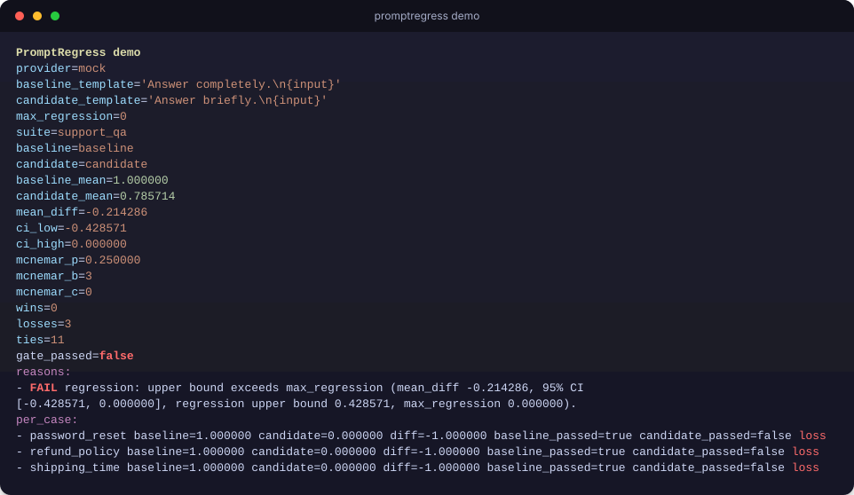
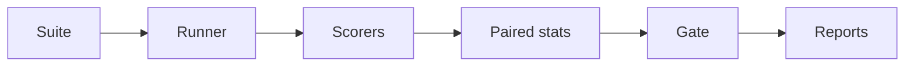
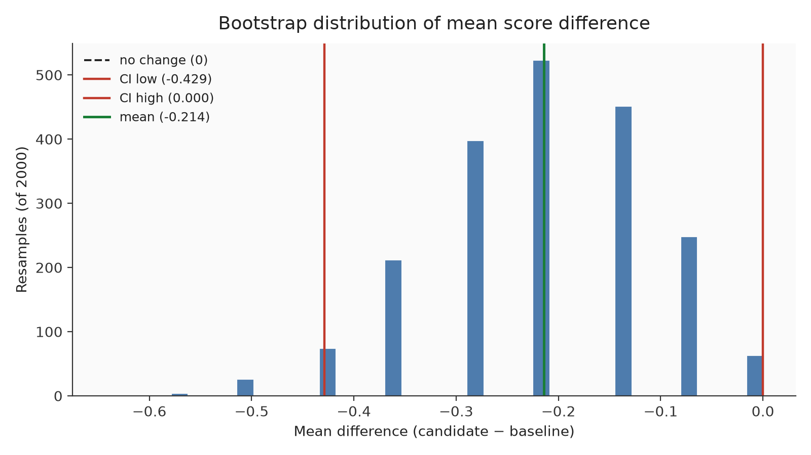
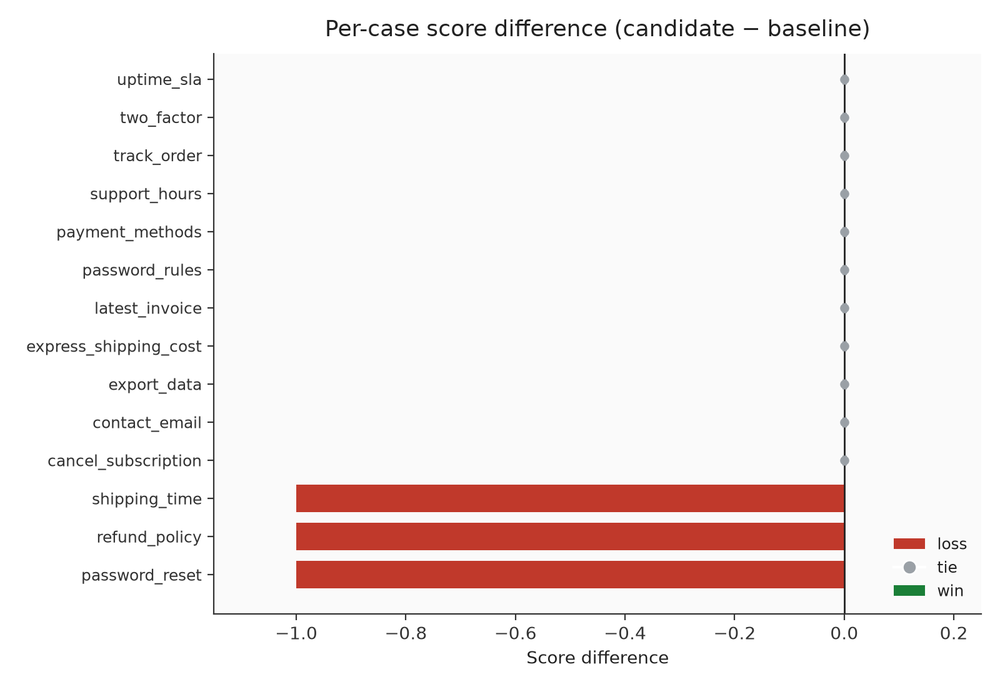
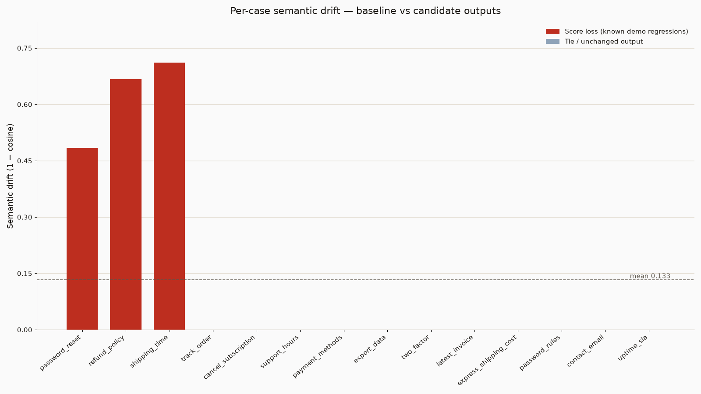

# PromptRegress

<p align="center">
  
</p>

<p align="center">
  <a href="https://github.com/balamuruganpg/promptregress/actions/workflows/ci.yml"></a>
  
  
  
  
</p>

Regression-test LLM prompts and models with paired bootstrap CIs, McNemar, and a CI gate — offline demo included, no API key.



## What it does

| | |
|---|---|
| 📋 **Fixed suite** | Same cases for baseline and candidate |
| 🏃 **Runner** | Mock / echo / OpenAI-compatible / Anthropic providers |
| ✅ **Scorers** | Exact + graded assertions in `[0, 1]`, optional per-scorer weights |
| 📊 **Paired diffs** | `dᵢ = score(candidate, i) − score(baseline, i)`, percentile or BCa CI |
| 🔀 **McNemar** | Pass/fail flips, plus Wilcoxon, paired t, Cohen's dz, and per-tag slices |
| 🚦 **CI gate** | Fails when the regression upper bound exceeds budget. `--junit-xml` writes JUnit; `audit` lints suites |
| 📄 **Reports** | JSON, Markdown, self-contained HTML |
| 🧩 **Failure clusters** | Group score regressions with a hash, TF-IDF, or transformer embedder |
| ⚖️ **Judges** | Pairwise preference, human calibration, position and verbosity bias, and `llm_judge` ensembles (mean of the judge scores) |
| 📐 **IRT & power** | 2PL case difficulty, and how many pairs a paired effect needs |
| 🗂️ **Matrix** | Rank named configs by mean score, with a CI against the best |
| 📈 **History** | Append each run and plot the mean-score trend |
| 📉 **Drift, sampling & cost** | Output cosine drift on compare; `--samples` for repeated scoring; `--pricing` YAML/JSON for USD cost |
| 📌 **Baselines, diff view & schema** | `--save-baseline` stores a run; `compare --baseline-name` scores the candidate only; `flaky` reports pass-flip rates across stored runs; HTML output diff; `schema` and `validate` |



## Verified demo

`promptregress demo` · mock provider · seed 13 · 2000 resamples · `--max-regression 0`

| | |
|---|---|
| Baseline / candidate mean | 1.000 / 0.786 |
| Mean difference | −0.214 |
| 95% bootstrap CI | [−0.429, 0.000] |
| McNemar (b=3, c=0) | p = 0.250 |
| Wins / losses / ties | 0 / 3 / 11 |
| Gate | **FAIL** (exit 1) |
| Cases lost | `password_reset`, `refund_policy`, `shipping_time` |



*Bootstrap mean-diffs (seed 13): CI bounds and zero marked.*



*Per-case diffs — losses in red, ties in grey.*



*Per-case semantic drift (1 − cosine) — demo losses highlighted.*

[See a real HTML report](docs/examples/report.html)

## Quickstart

```bash
python -m pip install -e ".[dev]"
promptregress demo
promptregress init ./my-eval
promptregress compare examples/support_qa.json --provider echo \
  --baseline-template "{input}" --candidate-template "{input}" \
  --max-regression 0 --report-html report.html
```

`run` exits 0 after scoring. `compare` / `demo` exit 1 on gate fail, 2 on bad args/suite.

The [user guide](docs/GUIDE.md) walks through a first suite, the gate, baselines, a judge ensemble, and maintenance commands.

<details>
<summary><strong>Deep dive — statistics &amp; gate</strong></summary>

Cases pair by id (mismatched ids error). Bootstrap resamples case-level diffs with replacement; percentile method with linear interpolation at rank `p/100 × (n_boot − 1)`; default 2000 resamples, seed 13, 95% CI (`alpha=0.05`).

McNemar on pass/fail: `b` = baseline pass / candidate fail, `c` = the reverse. `b == c` → p = 1. When `b + c < 25`, exact two-sided binomial `Binomial(b+c, 0.5)`; else continuity-corrected χ² with `erfc(√(χ²/2))`.

Score outcomes (tie eps `1e-12`): win / loss / tie on per-case scores.

Gate checks, in order:

1. Regression upper bound `-ci_low` > `max_regression` (default 0)
2. Candidate pass rate < `min_candidate_pass_rate` (default 0)
3. If `--require-significant`, require `ci_low > 0`
4. If `--max-mean-drift` is set, mean semantic drift must not exceed that budget

Each check records a reason with the numbers used. Small samples often include 0 in the CI and a non-significant McNemar — the gate still blocks when the regression upper bound exceeds budget. Drift is computed on every compare; the drift budget check runs only when `--max-mean-drift` is set.

</details>

<details>
<summary><strong>Deep dive — scorers</strong></summary>

Every scorer returns a float in `[0, 1]`. `score_case` clamps plugins into that range.

| Scorer | Type | Score |
| --- | --- | --- |
| `exact_match` | exact | 1 after strip, whitespace collapse, and casefold. `case_sensitive` skips casefold. Target is `value`, else the reference. |
| `contains` | exact | 1 when the normalized target is a substring of the normalized output. |
| `regex` | exact | 1 when `re.search` finds `value` in the raw output. `ignore_case` is optional. A bad pattern raises. |
| `json_valid` | exact | 1 when the stripped output parses as JSON. |
| `json_schema` | exact | 1 when the output validates against a subset schema in `value`. |
| `numeric_tolerance` | graded | 1 when the first number is within absolute `params.tol` (default 0). Otherwise a linear decay, then 0. |
| `levenshtein` | graded | `1 - edit_distance / max(len, len)` after strip. Casefold unless `case_sensitive`. |
| `tfidf_cosine` | graded | Cosine of smoothed TF-IDF vectors. `mode` is `word` or `char`. `ngram` defaults to 1. |
| `llm_judge` | graded | A judge provider scores the output against `params.rubric`. Parses a plain number, JSON `{"score": n}`, or `Score: n`. Failures score 0 and record an error. `params.judges` lists judge configs; the score is their mean. |
| `trace_match` | graded | Fraction of expected `{tool, args}` steps matched in order (longest subsequence). Tool names are equal. Each expected arg text is a case-sensitive substring of the actual value. An empty expected trace scores 1. Output that is not a JSON list scores 0. |

Pass rule:

- Every exact-type score must be at least 0.999.
- If any graded scorer is present, the weighted mean must also be at least 0.5.
- With only exact-type scorers, the weighted-mean check is not applied.
- No assertions → score 0, not passed.

Per-scorer weights live on the suite, next to the scorers each case already lists:

```yaml
scoring:
  weights:
    exact_match: 1
    levenshtein: 3
```

The case score multiplies each assertion weight by `scoring.weights` for that kind. Kinds left out use 1. Omitting the map, or setting every weight equal, keeps the previous mean. `scores` on the case result stays the unweighted mean of each kind. An unknown scorer, a negative weight, or a map of all zeros is a config error.

`numeric_tolerance` reads the first number (optional sign, integer or decimal, optional exponent). `1,000` reads as `1`. Let `delta = abs(found - expected)` and `window = tol` when `tol > 0`, else `1`. Score is 1 when `delta <= tol`, else `max(0, 1 - (delta - tol) / window)`.

`tfidf_cosine` uses `idf = log((1 + N) / (1 + df)) + 1` with `N = 2`. Both sides empty → 1; one side empty → 0.

`json_schema` implements `type`, `required`, `properties`, `items`, and `enum`. Booleans are not numbers. Extra object keys allowed; other keywords not enforced.

`trace_match` reads the expected trace from the assertion `value`, a list of `{tool, args}` steps. That field already holds structured documents, the same way `json_schema` holds a schema. `params` is not used. Strings compare as written. Other JSON arg values compare as `json.dumps` text (`true`, `false`, `null`). Extra actual steps do not lower the score, and each actual step is used at most once. A missing middle step still credits later steps that stay in order. The count is the longest in-order pairing, not a greedy left-to-right scan.

Plugins: `@register_scorer("name")` or `@register_scorer("name", exact=True)` with signature `(output, case, assertion) -> float`. Entry-point group `promptregress.scorers` loads callables as graded scorers (built-ins not replaced).

```python
from promptregress.providers import MockProvider
from promptregress.scorers import ScoringContext, score_case

context = ScoringContext(judge=MockProvider(default='{"score": 0.8}'))
scores, score, passed = score_case(case, output, context=context)
```

</details>

<details>
<summary><strong>Deep dive — providers &amp; CI</strong></summary>

| Provider | Behavior |
| --- | --- |
| `mock` | First substring rule wins, otherwise `default`. |
| `echo` | Returns the prompt unchanged. |
| `openai` | `POST {base_url}/chat/completions` via `urllib`. |
| `anthropic` | `POST https://api.anthropic.com/v1/messages` via `urllib`. |

`OpenAICompatibleProvider` uses constructor args or `PROMPTREGRESS_API_KEY` / `PROMPTREGRESS_BASE_URL` / `PROMPTREGRESS_MODEL` (defaults: `https://api.openai.com/v1`, `gpt-4o-mini`). Retries with exponential backoff (3 attempts). Response cache: SHA-256 of `provider + NUL + model + NUL + prompt`.

`AnthropicProvider` (`--provider anthropic`) sends `x-api-key` from the constructor or `ANTHROPIC_API_KEY`, `anthropic-version: 2023-06-01`, and `max_tokens` (default 1024). The default model is `claude-sonnet-4-6`. Text blocks are concatenated. `input_tokens` and `output_tokens` map to prompt and completion tokens. A missing key or a non-200 status raises `ProviderError` (the message includes the status). Retries match the OpenAI-compatible client.

```yaml
# CI sketch — exit 1 fails the job
- run: |
    promptregress compare examples/support_qa.json \
      --provider echo \
      --baseline-template "{input}" \
      --candidate-template "{input}" \
      --max-regression 0 \
      --report-html report.html
```

Checkout stays in the caller job. `uses: ./` installs this repo; a copy of `action.yml` with no `pyproject.toml` installs `promptregress` from PyPI. The step fails when the gate fails. Set `report-json`, `report-md`, or `report-html` to upload those artifacts.

```yaml
- uses: ./
  with:
    suite: examples/support_qa.json
    baseline-config: "{input}"
    candidate-config: "Answer briefly.\n{input}"
    max-regression: "0"
```

</details>

<details>
<summary><strong>Deep dive — limitations</strong></summary>

- `json_schema` is a subset — not full Draft 2020-12.
- `llm_judge` depends on the judge model/rubric; parse failures score 0.
- Bootstrap defaults to the percentile interval. `--ci-method bca` selects BCa and falls back when the jackknife is degenerate. Small n still means a wide interval; the gate uses the upper drop bound.
- McNemar is pass/fail; score losses can disagree with the p-value.
- TF-IDF here is two-document smoothed IDF, not semantic similarity.
- `MockProvider` is a fixture, not an LLM model.
- HTML report is one file with inline CSS — no external chart library.

</details>

## License

MIT. Copyright (c) 2026 Balamurugan P G. See [LICENSE](LICENSE).
