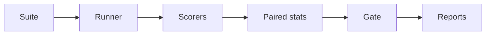

# PromptRegress

<p align="center">
  
</p>

<p align="center">
  <a href="https://github.com/balamuruganpg/promptregress/actions/workflows/ci.yml"></a>
  
  
  
  
</p>

Regression-test LLM prompts and models with paired bootstrap CIs, McNemar, and a CI gate — offline demo included, no API key.


## What it does

| | |
|---|---|
| 📋 **Fixed suite** | Same cases for baseline and candidate |
| 🏃 **Runner** | Mock / echo / OpenAI-compatible / Anthropic providers |
| ✅ **Scorers** | Exact + graded assertions in `[0, 1]`, optional per-scorer weights |
| 📊 **Paired diffs** | `dᵢ = score(candidate, i) − score(baseline, i)`, percentile or BCa CI |
| 🔀 **McNemar** | Pass/fail flips, plus Wilcoxon, paired t, Cohen's dz, and per-tag slices |
| 🚦 **CI gate** | Fails when the regression upper bound, mean drift, estimated cost, or p95 latency exceeds its budget. `--github-annotations` writes Actions `::error` lines. `--junit-xml` writes JUnit; `audit` lints suites |
| 📄 **Reports** | JSON, Markdown, self-contained HTML |
| 🧩 **Failure clusters** | Group score regressions with a hash, TF-IDF, or transformer embedder |
| ⚖️ **Judges** | Pairwise preference, human calibration, split-conformal pass threshold, position and verbosity bias, and `llm_judge` ensembles (mean of the judge scores) |
| 📐 **IRT & power** | 2PL case difficulty, and how many pairs a paired effect needs |
| 🗂️ **Matrix** | Rank named configs by mean score, with a CI against the best |
| 📈 **History** | Append each run and plot the mean-score trend |
| 🎯 **Regression risk** | Rank cases that resembled past regressions, before trusting the candidate |
| 🧪 **Surface synth** | `synth` writes adversarial input variants; `run` and `compare` score that file as a normal suite |
| 🏁 **Pareto frontier** | Mark variants that nobody else dominates on score, cost, and latency |
| 📍 **Change point** | One CUSUM shift in the recorded mean scores, with a permutation p-value |
| ✂️ **Section ablation** | Drop each `##` section and report its mean-score delta with a bootstrap CI |
| 📉 **Drift, sampling & cost** | Output cosine drift on compare; `--samples` for repeated scoring; `--pricing` YAML/JSON for USD cost |
| 📌 **Baselines, diff view & schema** | `--save-baseline` stores a run; `compare --baseline-name` scores the candidate only; `flaky` reports pass-flip rates across stored runs; HTML output diff; `schema` and `validate` |



## Verified demo

`promptregress demo` · mock provider · seed 13 · 2000 resamples · `--max-regression 0`

| | |
|---|---|
| Baseline / candidate mean | 1.000 / 0.786 |
| Mean difference | −0.214 |
| 95% bootstrap CI | [−0.429, 0.000] |
| McNemar (b=3, c=0) | p = 0.250 |
| Wins / losses / ties | 0 / 3 / 11 |
| Gate | **FAIL** (exit 1) |
| Cases lost | `password_reset`, `refund_policy`, `shipping_time` |


*Bootstrap mean-diffs (seed 13): CI bounds and zero marked.*


*Per-case diffs — losses in red, ties in grey.*


*Per-case semantic drift (1 − cosine) — demo losses highlighted.*

[See a real HTML report](docs/examples/report.html)

## Quickstart

```bash
python -m pip install -e ".[dev]"
promptregress demo
promptregress init ./my-eval
promptregress compare examples/support_qa.json --provider echo \
  --baseline-template "{input}" --candidate-template "{input}" \
  --max-regression 0 --report-html report.html
```

`run` exits 0 after scoring, including when cases fail. It exits 1 when `--max-cost-usd` or `--max-p95-latency-ms` is set and that run is over the budget. `compare` / `demo` exit 1 on gate fail, 2 on bad args/suite.

`--github-annotations` on `run` and `compare` writes one GitHub Actions `::error` command to stderr per failed case: `file`, `line` when the suite records one, the case id, the failing assertion, and the score. The same lines are written when `GITHUB_ACTIONS=true`. A gate failure with no failed case (drift, or a cost or latency budget) writes one `::error` summary instead.

`--max-cost-usd` and `--max-p95-latency-ms` fail the gate when the candidate's estimated cost or p95 case latency is above the budget. Cost uses `--pricing`. An equal value passes. Leaving a flag unset skips that check. `run` applies the same two limits to its single run.

The [user guide](docs/GUIDE.md) walks through a first suite, the gate, baselines, a judge ensemble, and maintenance commands.

<details>
<summary><strong>Deep dive — statistics &amp; gate</strong></summary>

Cases pair by id (mismatched ids error). Bootstrap resamples case-level diffs with replacement; percentile method with linear interpolation at rank `p/100 × (n_boot − 1)`; default 2000 resamples, seed 13, 95% CI (`alpha=0.05`).

McNemar on pass/fail: `b` = baseline pass / candidate fail, `c` = the reverse. `b == c` → p = 1. When `b + c < 25`, exact two-sided binomial `Binomial(b+c, 0.5)`; else continuity-corrected χ² with `erfc(√(χ²/2))`.

Score outcomes (tie eps `1e-12`): win / loss / tie on per-case scores.

Gate checks, in order:

1. Regression upper bound `-ci_low` > `max_regression` (default 0)
2. Candidate pass rate < `min_candidate_pass_rate` (default 0)
3. If `--require-significant`, require `ci_low > 0`
4. If `--max-mean-drift` is set, mean semantic drift must not exceed that budget
5. If `--max-cost-usd` is set, the candidate's estimated cost must not exceed it. Cost is the `estimate_cost` value stored on that run. A missing estimate fails the check
6. If `--max-p95-latency-ms` is set, the candidate's p95 case latency must not exceed it

Each check records a reason with the numbers used. Small samples often include 0 in the CI and a non-significant McNemar — the gate still blocks when the regression upper bound exceeds budget. Drift is computed on every compare; the drift budget check runs only when `--max-mean-drift` is set. Cost and latency checks run only when their flags are set. An equal cost or an equal p95 passes. `run` applies checks 5 and 6 to its one run and does not run checks 1–4.

</details>

<details>
<summary><strong>Deep dive — scorers</strong></summary>

Every scorer returns a float in `[0, 1]`. `score_case` clamps plugins into that range.

| Scorer | Type | Score |
| --- | --- | --- |
| `exact_match` | exact | 1 after strip, whitespace collapse, and casefold. `case_sensitive` skips casefold. Target is `value`, else the reference. |
| `contains` | exact | 1 when the normalized target is a substring of the normalized output. |
| `regex` | exact | 1 when `re.search` finds `value` in the raw output. `ignore_case` is optional. A bad pattern raises. |
| `json_valid` | exact | 1 when the stripped output parses as JSON. |
| `json_schema` | exact | 1 when the output validates against a subset schema in `value`. |
| `numeric_tolerance` | graded | 1 when the first number is within absolute `params.tol` (default 0). Otherwise a linear decay, then 0. |
| `levenshtein` | graded | `1 - edit_distance / max(len, len)` after strip. Casefold unless `case_sensitive`. |
| `tfidf_cosine` | graded | Cosine of smoothed TF-IDF vectors. `mode` is `word` or `char`. `ngram` defaults to 1. |
| `llm_judge` | graded | A judge provider scores the output against `params.rubric`. Parses a plain number, JSON `{"score": n}`, or `Score: n`. Failures score 0 and record an error. `params.judges` lists judge configs; the score is their mean. |
| `trace_match` | graded | Fraction of expected `{tool, args}` steps matched in order (longest subsequence). Tool names are equal. Each expected arg text is a case-sensitive substring of the actual value. An empty expected trace scores 1. Output that is not a JSON list scores 0. |

Pass rule:

- Every exact-type score must be at least 0.999.
- If any graded scorer is present, the weighted mean must also be at least 0.5.
- With only exact-type scorers, the weighted-mean check is not applied.
- No assertions → score 0, not passed.

Per-scorer weights live on the suite, next to the scorers each case already lists:

```yaml
scoring:
  weights:
    exact_match: 1
    levenshtein: 3
```

The case score multiplies each assertion weight by `scoring.weights` for that kind. Kinds left out use 1. Omitting the map, or setting every weight equal, keeps the previous mean. `scores` on the case result stays the unweighted mean of each kind. An unknown scorer, a negative weight, or a map of all zeros is a config error.

`numeric_tolerance` reads the first number (optional sign, integer or decimal, optional exponent). `1,000` reads as `1`. Let `delta = abs(found - expected)` and `window = tol` when `tol > 0`, else `1`. Score is 1 when `delta <= tol`, else `max(0, 1 - (delta - tol) / window)`.

`tfidf_cosine` uses `idf = log((1 + N) / (1 + df)) + 1` with `N = 2`. Both sides empty → 1; one side empty → 0.

`json_schema` implements `type`, `required`, `properties`, `items`, and `enum`. Booleans are not numbers. Extra object keys allowed; other keywords not enforced.

`trace_match` reads the expected trace from the assertion `value`, a list of `{tool, args}` steps. That field already holds structured documents, the same way `json_schema` holds a schema. `params` is not used. Strings compare as written. Other JSON arg values compare as `json.dumps` text (`true`, `false`, `null`). Extra actual steps do not lower the score, and each actual step is used at most once. A missing middle step still credits later steps that stay in order. The count is the longest in-order pairing, not a greedy left-to-right scan.

Plugins: `@register_scorer("name")` or `@register_scorer("name", exact=True)` with signature `(output, case, assertion) -> float`. Entry-point group `promptregress.scorers` loads callables as graded scorers (built-ins not replaced).

```python
from promptregress.providers import MockProvider
from promptregress.scorers import ScoringContext, score_case

context = ScoringContext(judge=MockProvider(default='{"score": 0.8}'))
scores, score, passed = score_case(case, output, context=context)
```

</details>

<details>
<summary><strong>Deep dive — providers &amp; CI</strong></summary>

| Provider | Behavior |
| --- | --- |
| `mock` | First substring rule wins, otherwise `default`. |
| `echo` | Returns the prompt unchanged. |
| `openai` | `POST {base_url}/chat/completions` via `urllib`. |
| `anthropic` | `POST https://api.anthropic.com/v1/messages` via `urllib`. |

`OpenAICompatibleProvider` uses constructor args or `PROMPTREGRESS_API_KEY` / `PROMPTREGRESS_BASE_URL` / `PROMPTREGRESS_MODEL` (defaults: `https://api.openai.com/v1`, `gpt-4o-mini`). Retries with exponential backoff (3 attempts). Response cache: SHA-256 of `provider + NUL + model + NUL + prompt`.

`AnthropicProvider` (`--provider anthropic`) sends `x-api-key` from the constructor or `ANTHROPIC_API_KEY`, `anthropic-version: 2023-06-01`, and `max_tokens` (default 1024). The default model is `claude-sonnet-4-6`. Text blocks are concatenated. `input_tokens` and `output_tokens` map to prompt and completion tokens. A missing key or a non-200 status raises `ProviderError` (the message includes the status). Retries match the OpenAI-compatible client.

```yaml
# CI sketch — exit 1 fails the job
- run: |
    promptregress compare examples/support_qa.json \
      --provider echo \
      --baseline-template "{input}" \
      --candidate-template "{input}" \
      --max-regression 0 \
      --report-html report.html
```

Checkout stays in the caller job. `uses: ./` installs this repo; a copy of `action.yml` with no `pyproject.toml` installs `promptregress` from PyPI. The step fails when the gate fails. Set `report-json`, `report-md`, or `report-html` to upload those artifacts.

```yaml
- uses: ./
  with:
    suite: examples/support_qa.json
    baseline-config: "{input}"
    candidate-config: "Answer briefly.\n{input}"
    max-regression: "0"
```

</details>

<details>
<summary><strong>Deep dive — limitations</strong></summary>

- `json_schema` is a subset — not full Draft 2020-12.
- `llm_judge` depends on the judge model/rubric; parse failures score 0.
- Bootstrap defaults to the percentile interval. `--ci-method bca` selects BCa and falls back when the jackknife is degenerate. Small n still means a wide interval; the gate uses the upper drop bound.
- McNemar is pass/fail; score losses can disagree with the p-value.
- TF-IDF here is two-document smoothed IDF, not semantic similarity.
- `MockProvider` is a fixture, not an LLM model.
- HTML report is one file with inline CSS — no external chart library.
- `synth` perturbs surface form only. It does not create new knowledge tests, and keeping the original answer is assumed, not proven.
- The Pareto frontier describes only the runs in the files you pass. It is not a confidence interval, and it does not change the gate. It does not check that those runs used the same cases. Matrix ranking JSON is not an input: it has a mean score and no per-config cost or latency.
- Section ablation is leave-one-out on this suite and provider. The interval is that section's marginal contribution here. It does not travel to another suite, provider, or case distribution, and sections can interact.

</details>

<details>
<summary><strong>Deep dive — conformal judge threshold</strong></summary>

`calibrate` reports Pearson, Spearman, MAE, and kappa. `--conformal-alpha`
(default 0.1) fits a split-conformal threshold on the gold-fail judge scores
that bounds the false-pass rate at that alpha under exchangeability.

Gold pass/fail uses the same `--threshold` cut as kappa (default 0.5). The
cut is the `ceil((n + 1) (1 - alpha))`-th order statistic of the `n`
gold-fail scores, or `+inf` (never pass) when that index is `n + 1`. Pass
if `score >= threshold`; a tie at the cut is a pass. The printed
`guaranteed_bound` is `floor(alpha * (n + 1)) / (n + 1)`, which is at most
alpha. The bound is for a new gold-fail example exchangeable with the
calibration fails. It does not bound false-fails, survive a distribution
shift, or treat the empirical rate on a finite test set as a hard cap.

```bash
promptregress calibrate examples/calibrate/labels.jsonl \
  --rubric "Score the answer from 0 to 1 against the reference." \
  --judge-provider mock \
  --mock-rules "$(cat examples/calibrate/rules.json)" \
  --conformal-alpha 0.25
```

```text
calibration
n=6
pearson=0.786991
spearman=0.828079
mae=0.250000
threshold=0.500000
kappa=0.666667
raw_agreement=0.833333
both_pass=2
judge_only=1
human_only=0
both_fail=3

conformal
alpha=0.250000
n=4
threshold=0.800000
guaranteed_bound=0.200000
empirical_error=0.250000

| human_score | judge_score |
| ---: | ---: |
| 0.000000 | 0.100000 |
| 0.000000 | 0.200000 |
| 0.000000 | 0.300000 |
| 0.000000 | 0.800000 |
| 1.000000 | 0.900000 |
| 1.000000 | 1.000000 |
```

Four gold-fail scores (0.1, 0.2, 0.3, 0.8): `(n+1)(1-alpha) = 5 × 0.75 = 3.75`,
so `k = 4` and the threshold is 0.8. `guaranteed_bound = floor(0.25 × 5) / 5 = 0.2`.
One of those four fails still passes at 0.8, so `empirical_error=0.250000`.
The JSON document repeats `conformal.threshold` as `0.8`.

</details>

<details>
<summary><strong>Deep dive — regression risk</strong></summary>

`promptregress risk` fits a logistic regression to past comparison reports
(`compare --report-json`) and ranks cases by how much they look like cases
that regressed before. The label is 1 when the candidate score is strictly
below the baseline score, and 0 otherwise. Features are baseline-side only:
baseline score, baseline latency, input length in characters, baseline
output length, tag count, and a 0/1 indicator for each common scorer kind.
The candidate score is the label, so it is not a feature. Ordinary
comparison JSON does not store the case input, so input length is 0 unless
the file includes `case_input`.

With two or more reports, pass them oldest first. The last file is the
holdout and does not affect the coefficients. One file holds out the last
20% of cases. The report prints the training size and the holdout AUC
(Mann-Whitney rank statistic). `--target` ranks that report's baseline
cases. `--json` prints the same report as JSON. `--out` writes it.

The score is an estimate of the chance the candidate score drops. It is a
ranking aid, not a guarantee, and the gate does not read it. Fewer than 20
labeled cases, a single class, or a one-class holdout split refuses instead
of inventing a ranking.

`examples/risk/` is four synthetic comparisons. The first three train the
model. `cmp_04.json` is the target. The six `risk_*` cases drop; the six
`safe_*` cases do not. This command was run in this repo:

```bash
promptregress risk examples/risk/cmp_01.json examples/risk/cmp_02.json \
  examples/risk/cmp_03.json --target examples/risk/cmp_04.json --top 5
```

```text
risk
n_comparisons=3
n_cases=36
n_train=24
n_holdout=12
holdout_split=last_comparison
holdout_auc=1.000000
iterations=800
learning_rate=0.500000
l2=0.010000
note=Features use the baseline side and case metadata only, so the ranking does not look at the candidate run. The score estimates the chance the candidate score drops below the baseline. It is a ranking aid, not a guarantee, and it does not change the gate.
target=examples/risk/cmp_04.json
- risk_4 probability=0.996932 observed_regressed=1
  n_tags contribution=0.851939 coefficient=0.632400 standardized_value=1.347151
  input_length contribution=0.769698 coefficient=0.566223 standardized_value=1.359354
  baseline_output_length contribution=0.766475 coefficient=0.604235 standardized_value=1.268504
- risk_5 probability=0.996288 observed_regressed=1
  input_length contribution=0.927315 coefficient=0.566223 standardized_value=1.637720
  baseline_output_length contribution=0.886370 coefficient=0.604235 standardized_value=1.466930
  baseline_latency_ms contribution=0.796810 coefficient=0.643672 standardized_value=1.237912
- risk_2 probability=0.994473 observed_regressed=1
  n_tags contribution=0.851939 coefficient=0.632400 standardized_value=1.347151
  baseline_score contribution=0.680024 coefficient=-0.682083 standardized_value=-0.996982
  scorer_contains contribution=0.669785 coefficient=0.669785 standardized_value=1.000000
- risk_3 probability=0.993315 observed_regressed=1
  baseline_latency_ms contribution=0.675806 coefficient=0.643672 standardized_value=1.049923
  scorer_contains contribution=0.669785 coefficient=0.669785 standardized_value=1.000000
  scorer_exact_match contribution=0.669785 coefficient=-0.669785 standardized_value=-1.000000
- risk_0 probability=0.990062 observed_regressed=1
  n_tags contribution=0.851939 coefficient=0.632400 standardized_value=1.347151
  baseline_score contribution=0.764961 coefficient=-0.682083 standardized_value=-1.121508
  scorer_contains contribution=0.669785 coefficient=0.669785 standardized_value=1.000000
```

`observed_regressed` is the target file's label, printed for inspection. It
is not a model input. `contribution` is the coefficient times the
standardized feature value. The top five cases are all planted regressions.

</details>

## Prompt-section ablation

`promptregress ablate` splits a candidate template on `## Section` headings, scores the full prompt, then scores the suite again with each section removed. The delta is the mean of `score(without the section) - score(full prompt)`. The interval is a 95% percentile bootstrap of that paired mean (seed 13, 2000 resamples), from the same helper `compare` uses.

A heading is a line that starts with `##`, then a space or tab, then a name. `#` and `###` lines are body text. Text before the first heading is kept in every version. `{input}` and `{reference}` are filled in after the section is removed. Two sections with the same name, or a template with none, is an error (exit 2).

The interval is that section's marginal contribution on this suite and provider. Sections can interact, and a block that matters on other cases can look unused here.

This command was run in this repo:

```bash
promptregress ablate \
  --suite examples/ablate/suite.json \
  --provider mock \
  --mock-rules "$(cat examples/ablate/rules.json)" \
  --template "$(cat examples/ablate/template.txt)"
```

```text
ablation
suite=ablation-demo
n_cases=4
full_mean=1.000000
preamble_chars=32
n_boot=2000
seed=13
alpha=0.050000
ci_method=percentile
note=Delta is the mean of per-case score without the section, minus the full-prompt score. The interval is a bootstrap confidence interval for that paired mean on this suite and provider. It is a marginal contribution under this measurement, not causal importance in general. Sections can interact, and a section that matters on other cases can look unused here. A per-case difference within 1e-12 counts as no change, the same tie band compare uses.
- Policy mean=0.000000 delta=-1.000000 ci=[-1.000000, -1.000000] cases_affected=4
  cases: hours, refund, shipping, warranty
- Tone mean=1.000000 delta=0.000000 ci=[0.000000, 0.000000] cases_affected=0
```

`preamble_chars=32` is the intro `Answer using the named blocks.` plus the blank line, kept in every run. `Policy` holds `POLICY::{input}`, which is the text the mock matches, so removing it scores every case 0 and the interval stays at -1.000000. `Tone` is a greeting the mock ignores: the delta is 0.000000 and the interval contains 0. Removing `Policy` also removes `{input}`, so those four cases render one shared prompt and the response cache reuses it.

## Adversarial suite synthesis

`promptregress synth` reads a suite and writes a **new** file. It does not modify the input. Each case input is perturbed by one operator at a time. References, assertions, tags, and scoring weights are copied. The new case id is `{source_id}__{operator}` (plus `__{index}` when `--per-case` is greater than 1). Metadata records `source_case_id`, `operator`, `variant_index`, and `changed`.

`run` and `compare` score that file as an ordinary suite. No extra flag is required. Pairing is between two configs on the variant cases, not between a variant and its source case.

Operators, in default order: `whitespace_casing`, `punctuation`, `synonym` (a fixed ten-word map), `instruction_rephrase` (`Please answer: …` or `Q: … A:`), `distractor` (one sentence from a fixed pool of four), `homoglyph` (Cyrillic lookalikes for `a e o p c x`), and `number_format` (`1,000` ↔ `1000`, where that form is unambiguous). An operator that does not apply leaves the input unchanged and still writes the case, with `changed` false. The case count is source cases × operators × `--per-case`. The same `--seed` rebuilds the same file. Choices use that seed directly. There is no global random stream.

These edits test surface robustness. They do not add facts or new labels. A synonym, a wrapper, or a homoglyph can still change the task. Label preservation is assumed, not proven.

This command was run in this repo (`--seed` defaults to 13):

```bash
promptregress synth --suite examples/support_qa.json \
  --out /tmp/support_qa_synth.json --seed 13
```

```text
synth
suite=examples/support_qa.json
out=/tmp/support_qa_synth.json
in_cases=14
out_cases=98
changed=70
operators=whitespace_casing,punctuation,synonym,instruction_rephrase,distractor,homoglyph,number_format
per_case=1
seed=13
```

`promptregress validate /tmp/support_qa_synth.json` printed `/tmp/support_qa_synth.json: OK`. The 28 unchanged cases are every `synonym` and `number_format` variant: this suite's questions contain none of the mapped words and no thousands-formatted number. `password_reset` illustrates the ones that did change. The reference and the original assertions are unchanged on each.

| Operator | Input |
| --- | --- |
| `whitespace_casing` | `How do I reset mY  password?` |
| `punctuation` | `How do I reset my password.` |
| `instruction_rephrase` | `Please answer: How do I reset my password?` |
| `distractor` | `An unrelated sentence about office plants sits here. How do I reset my password?` |
| `homoglyph` | `Hоw do I reset my password?` (the `o` is U+043E) |

`promptregress run /tmp/support_qa_synth.json --provider echo --config-name synth-echo --out /tmp/support_qa_synth_run.json` scored all 98 cases and exited 0. Echo returns the prompt, so that score is not a robustness result.

## Pareto frontier

`promptregress pareto` reads comparison JSON (`compare --report-json`) and run JSON (`run --out`). A comparison contributes its baseline and its candidate. A run contributes that one config. The name is the config name. The score is the run's mean score. Cost is `cost.usd` when the run recorded a finite estimate. Latency is the mean of the per-case latencies, in milliseconds. Score is maximised. Cost and latency are minimised. A variant is dominated when another is at least as good on every axis in use and strictly better on one. Equal values on every axis stay on the frontier together. There is no `1e-12` tie band. If every variant is missing cost, or every variant is missing latency, that axis is omitted and the report names it. A mix of present and missing on one axis is an error. Matrix ranking JSON is rejected: its rows store `mean_score` and do not store per-config cost or latency.

`dominated_by` is the closest variant that dominates this one. That variant may itself be dominated. Distance is Euclidean after each axis is oriented so larger is better and scaled to `[0, 1]` on this set. Equal distances break by name, ascending.

The frontier is only as good as the runs behind it. It does not turn those means into a confidence interval, and it does not change the gate.

`examples/pareto/` is one comparison and one run, written with the report writers. `comparison.json` is baseline `cheap` (case scores 1.0 and 0.0, latencies 10.0 ms and 30.0 ms, `cost.usd` 0.01) against candidate `quality` (scores 1.0 and 1.0, latencies 40.0 ms and 60.0 ms, `cost.usd` 0.05). `slow.json` scores 0.0 on both cases at 80.0 ms and has `cost.usd` 0.04. This command was run in this repo:

```bash
promptregress pareto examples/pareto/comparison.json examples/pareto/slow.json
```

```text
pareto
n=3
axes=score,cost,latency
omitted=none
note=A variant is dominated when another is at least as good on every axis in use and strictly better on one. Score is maximised. Cost is the estimated USD on the run and is minimised. Latency is the mean case latency in milliseconds and is minimised. Equal values on every axis in use do not dominate, so both variants stay on the frontier. There is no 1e-12 tie band. If cost is missing on every variant, or latency is, that axis is left out and named in omitted. A null cost.usd counts as missing cost. A mix of present and missing on one axis is an error. dominated_by is the closest dominating variant, which may itself be dominated. Distance is Euclidean after each axis is oriented so larger is better and scaled to [0, 1] by its minimum and maximum in this set. An axis with no spread contributes 0. Equal distances break by variant name, ascending, in code-point order. Frontier rows are listed first, by score descending, then by each minimised axis in use, ascending, then by name ascending. Dominated rows follow, by dominated_by ascending, then by that same key. The table rounds; JSON keeps the stored floats. The frontier describes only these runs. It is not a confidence interval, and it does not change the gate.

variant  score     cost        latency    frontier  dominated_by
quality  1.000000  0.05000000  50.000000  yes       -
cheap    0.500000  0.01000000  20.000000  yes       -
slow     0.000000  0.04000000  80.000000  no        cheap
```

`quality` and `cheap` are both on the frontier. `quality` scores 1.000000 against `cheap`'s 0.500000, and `cheap` costs 0.01000000 with mean latency 20.000000 against `quality`'s 0.05000000 and 50.000000. `slow` is worse than `cheap` on the printed score (0.000000), cost (0.04000000), and latency (80.000000), so `cheap` dominates it. `quality` does not: its cost 0.05000000 is higher than `slow`'s 0.04000000.

## Change-point detection

`promptregress changepoint` reads the same history file as `history` (`.promptregress/history.jsonl`, or `--file`). The series is `metrics.mean_score` in file order. A `compare` row contributes the candidate mean, the value history already stores. A row with no `mean_score` is left out of the series. `--json` prints the report as JSON. `--out` writes that JSON. The command exits 0 when it prints a report. It exits 2 when the history is empty, fewer than 8 scored runs remain, every scored mean is equal, or a present `mean_score` is not a finite number.

The change index `k` is the 0-based index of the first run in the after segment. It maximises `C_k = sqrt(k*(n-k)/n) * abs(before_mean - after_mean)` for `k` from 1 to `n-1`. Each segment mean is `math.fsum` of that segment divided by its length. The smallest `k` wins a tie. The mean shift is the after mean minus the before mean. The reported statistic is `C_k` at that index.

The p-value shuffles this series with `random.Random(--seed)`. The default seed is 13 and the default permutation count is 2000. The generator is local to the command. `p = (1 + the number of shuffles whose maximum C is at least the observed statistic) / (permutations + 1)`.

It reports a detected shift in the recorded means. It is not proof of cause, and it does not change the gate.

`examples/changepoint/history.jsonl` was written with `make_run_record` and `append_history` from the bundled support_qa demo. The first eight runs use `Answer completely.` (config name `full`, mean 1). The next eight use `Answer briefly.` (config name `brief`). On this suite the brief mean is 11/14: three of the 14 demo cases score 0 and the other eleven score 1. Timestamps run from `2026-11-12T00:00:00Z` through `2026-11-12T00:00:15Z`.

This command was run in this repo (seed 13, 2000 permutations):

```bash
promptregress changepoint --file examples/changepoint/history.jsonl
```

```text
changepoint
n=16
change_index=8
before_n=8
after_n=8
skipped=0
before_mean=1.000000
after_mean=0.785714
mean_shift=-0.214286
statistic=0.428571
p_value=0.000500
permutations=2000
seed=13
note=The series is metrics.mean_score in history-file order. change_index is the 0-based index of the first run after the split. It maximises C_k = sqrt(k*(n-k)/n) * abs(before_mean - after_mean) for k from 1 to n-1. Each segment mean is math.fsum of that segment divided by its length. The smallest k wins a tie. mean_shift is after_mean minus before_mean. The p-value is (1 + the number of permutations whose maximum C is at least the observed statistic) / (permutations + 1). Each permutation shuffles this series with random.Random(seed). That generator is local to the call. Text rounds to 6 decimals. JSON keeps the stored floats. It reports a detected shift in the recorded means. It is not proof of cause, and it does not change the gate.
before:
[0] record=0 timestamp=2026-11-12T00:00:00Z command=run suite=support_qa config_name=full provider=mock model=demo
[1] record=1 timestamp=2026-11-12T00:00:01Z command=run suite=support_qa config_name=full provider=mock model=demo
[2] record=2 timestamp=2026-11-12T00:00:02Z command=run suite=support_qa config_name=full provider=mock model=demo
[3] record=3 timestamp=2026-11-12T00:00:03Z command=run suite=support_qa config_name=full provider=mock model=demo
[4] record=4 timestamp=2026-11-12T00:00:04Z command=run suite=support_qa config_name=full provider=mock model=demo
[5] record=5 timestamp=2026-11-12T00:00:05Z command=run suite=support_qa config_name=full provider=mock model=demo
[6] record=6 timestamp=2026-11-12T00:00:06Z command=run suite=support_qa config_name=full provider=mock model=demo
[7] record=7 timestamp=2026-11-12T00:00:07Z command=run suite=support_qa config_name=full provider=mock model=demo
after:
[8] record=8 timestamp=2026-11-12T00:00:08Z command=run suite=support_qa config_name=brief provider=mock model=demo
[9] record=9 timestamp=2026-11-12T00:00:09Z command=run suite=support_qa config_name=brief provider=mock model=demo
[10] record=10 timestamp=2026-11-12T00:00:10Z command=run suite=support_qa config_name=brief provider=mock model=demo
[11] record=11 timestamp=2026-11-12T00:00:11Z command=run suite=support_qa config_name=brief provider=mock model=demo
[12] record=12 timestamp=2026-11-12T00:00:12Z command=run suite=support_qa config_name=brief provider=mock model=demo
[13] record=13 timestamp=2026-11-12T00:00:13Z command=run suite=support_qa config_name=brief provider=mock model=demo
[14] record=14 timestamp=2026-11-12T00:00:14Z command=run suite=support_qa config_name=brief provider=mock model=demo
[15] record=15 timestamp=2026-11-12T00:00:15Z command=run suite=support_qa config_name=brief provider=mock model=demo
```

`change_index=8` is `2026-11-12T00:00:08Z`, config `brief`. The run on the before side of that split is `2026-11-12T00:00:07Z`, config `full`. The before mean is 1.000000 and the after mean is 0.785714. The mean shift is -0.214286, which is 11/14 - 1. The statistic is 0.428571, which is `sqrt(8*8/16) * abs(1 - 11/14)` = 3/7. With seed 13, none of the 2000 permutations reached that statistic, so the p-value is 1/2001. Text prints it as 0.000500. JSON keeps 0.0004997501249375312. The process exited 0.

## License

MIT. Copyright (c) 2026 Balamurugan P G. See [LICENSE](LICENSE).
