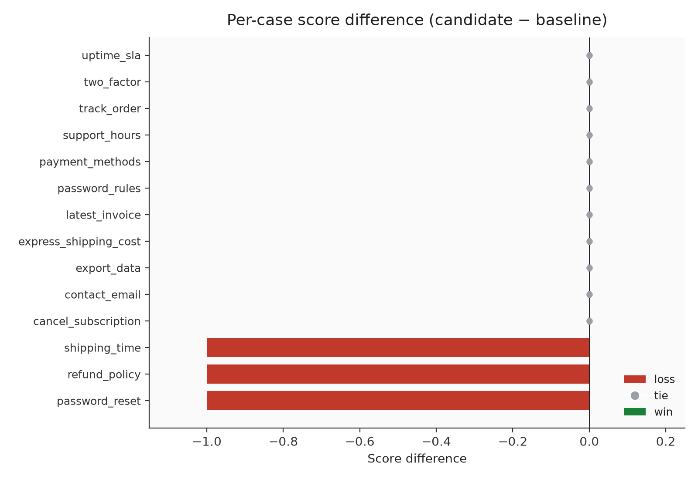
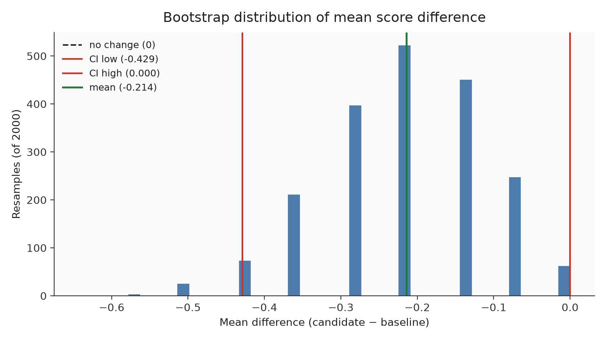
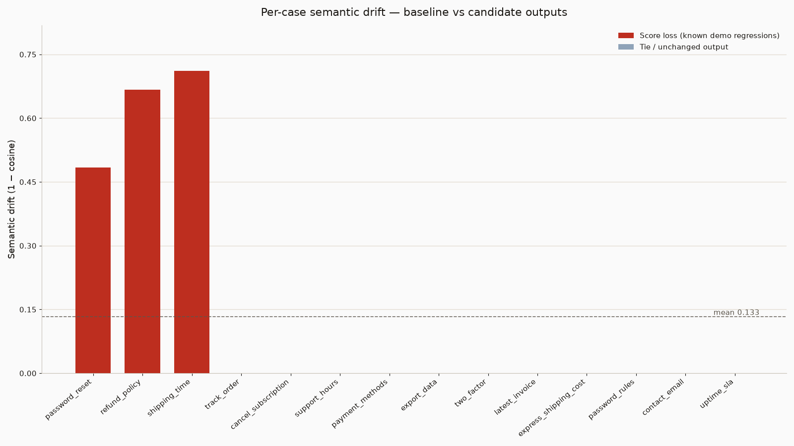
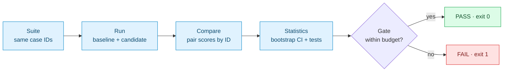
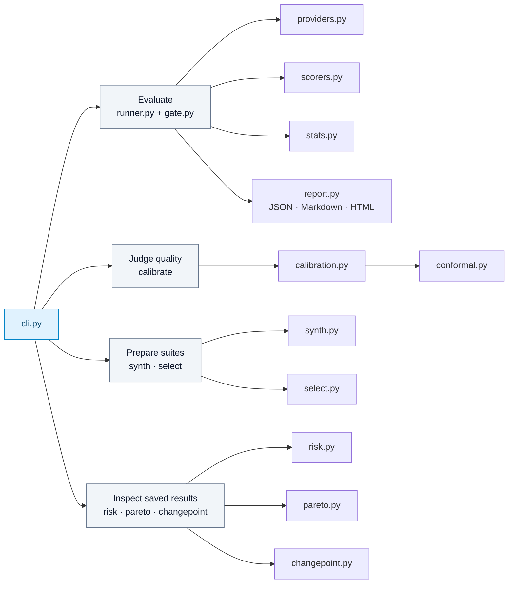
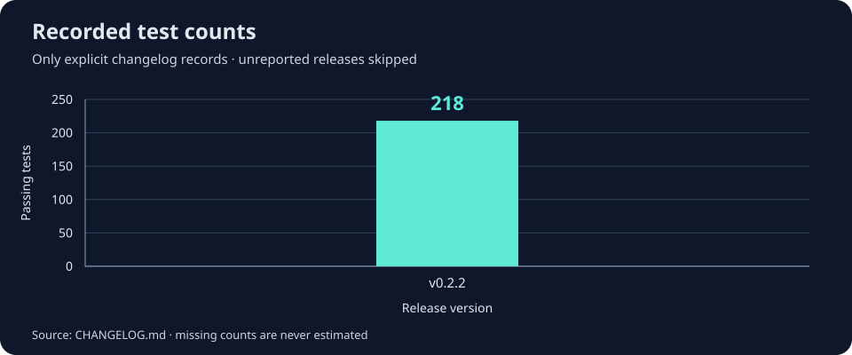

<h1 align="center">PromptRegress</h1>

<p align="center">Regression-test LLM prompts and models with paired statistics and a CI gate — offline demo included, no API key.</p>

<p align="center">
  
  
  
  <a href="LICENSE"></a>
  <a href="https://github.com/balamuruganpg/promptregress/actions/workflows/ci.yml"></a>
</p>

<p align="center">
  <a href="#quickstart">Quickstart</a> ·
  <a href="#verified-demo">Demo</a> ·
  <a href="#how-it-works">How it works</a> ·
  <a href="#feature-matrix">Features</a> ·
  <a href="#deep-dives">Deep dives</a>
</p>

## Quickstart

```bash
python -m pip install -e ".[dev]"
promptregress demo
promptregress init ./my-eval
promptregress compare examples/support_qa.json --provider echo \
  --baseline-template "{input}" --candidate-template "{input}" \
  --max-regression 0 --report-html report.html
```

The demo deliberately exits **1**: the shorter prompt loses required details. Run the next commands separately after inspecting its verdict.

`run` exits 0 after scoring, including when cases fail. It exits 1 when `--max-cost-usd` or `--max-p95-latency-ms` is set and that run is over the budget. `compare` / `demo` exit 1 on gate fail, 2 on bad args/suite.

[Walk through your first suite →](docs/GUIDE.md) · [Browse example suites →](examples/README.md) · [Open the sample HTML report →](docs/examples/report.html)

## Verified demo

`promptregress demo` · mock provider · seed 13 · 2000 resamples · `--max-regression 0`

| 🟦 Baseline mean | 🟧 Candidate mean | 📉 Mean difference | 🚦 Verdict |
| :---: | :---: | :---: | :---: |
| **1.000** | **0.786** | **−0.214** | **🔴 FAIL · exit 1** |
| `Answer completely.` | `Answer briefly.` | candidate − baseline | regression budget: **0** |

| 95% bootstrap CI | McNemar | Wins / losses / ties |
| :---: | :---: | :---: |
| **[−0.429, 0.000]** | **p = 0.250** (`b=3`, `c=0`) | **0 / 3 / 11** |

<details>
<summary><strong>▶ Replay the demo — complete terminal output</strong></summary>

```text
PromptRegress demo
provider=mock
baseline_template='Answer completely.\n{input}'
candidate_template='Answer briefly.\n{input}'
max_regression=0
suite=support_qa
baseline=baseline
candidate=candidate
baseline_mean=1.000000
candidate_mean=0.785714
baseline_pass_rate=1.000000
candidate_pass_rate=0.785714
baseline_mean_latency_ms=1.000000
baseline_p95_latency_ms=1.000000
baseline_total_tokens=1572
baseline_cached_cases=0
candidate_mean_latency_ms=1.000000
candidate_p95_latency_ms=1.000000
candidate_total_tokens=1375
candidate_cached_cases=0
mean_diff=-0.214286
ci_low=-0.428571
ci_high=0.000000
ci_level=95
ci_method=percentile
mcnemar_p=0.250000
mcnemar_b=3
mcnemar_c=0
wilcoxon_p=0.250000
ttest_p=0.082277
cohens_dz=-0.503236
effect_size=medium
wins=0
losses=3
ties=11
gate_passed=false
reasons:
- FAIL regression: upper bound exceeds max_regression (mean_diff -0.214286, 95% CI [-0.428571, 0.000000], regression upper bound 0.428571, max_regression 0.000000).
- PASS pass rate: candidate meets the minimum (candidate pass rate 0.785714, minimum 0.000000).
- PASS significance: require_significant is off.
slices:
- account n=1 mean_diff=-1.000000 ci_low=-1.000000 ci_high=-1.000000 wins=0 losses=1 ties=0
- billing n=4 mean_diff=-0.250000 ci_low=-0.750000 ci_high=0.000000 wins=0 losses=1 ties=3
- json n=1 mean_diff=0.000000 ci_low=0.000000 ci_high=0.000000 wins=0 losses=0 ties=1
- privacy n=1 mean_diff=0.000000 ci_low=0.000000 ci_high=0.000000 wins=0 losses=0 ties=1
- reliability n=1 mean_diff=0.000000 ci_low=0.000000 ci_high=0.000000 wins=0 losses=0 ties=1
- security n=3 mean_diff=-0.333333 ci_low=-1.000000 ci_high=0.000000 wins=0 losses=1 ties=2
- shipping n=3 mean_diff=-0.333333 ci_low=-1.000000 ci_high=0.000000 wins=0 losses=1 ties=2
- support n=2 mean_diff=0.000000 ci_low=0.000000 ci_high=0.000000 wins=0 losses=0 ties=2
per_case:
- password_reset baseline=1.000000 candidate=0.000000 diff=-1.000000 baseline_passed=true candidate_passed=false loss
- refund_policy baseline=1.000000 candidate=0.000000 diff=-1.000000 baseline_passed=true candidate_passed=false loss
- shipping_time baseline=1.000000 candidate=0.000000 diff=-1.000000 baseline_passed=true candidate_passed=false loss
- track_order baseline=1.000000 candidate=1.000000 diff=0.000000 baseline_passed=true candidate_passed=true tie
- cancel_subscription baseline=1.000000 candidate=1.000000 diff=0.000000 baseline_passed=true candidate_passed=true tie
- support_hours baseline=1.000000 candidate=1.000000 diff=0.000000 baseline_passed=true candidate_passed=true tie
- payment_methods baseline=1.000000 candidate=1.000000 diff=0.000000 baseline_passed=true candidate_passed=true tie
- export_data baseline=1.000000 candidate=1.000000 diff=0.000000 baseline_passed=true candidate_passed=true tie
- two_factor baseline=1.000000 candidate=1.000000 diff=0.000000 baseline_passed=true candidate_passed=true tie
- latest_invoice baseline=1.000000 candidate=1.000000 diff=0.000000 baseline_passed=true candidate_passed=true tie
- express_shipping_cost baseline=1.000000 candidate=1.000000 diff=0.000000 baseline_passed=true candidate_passed=true tie
- password_rules baseline=1.000000 candidate=1.000000 diff=0.000000 baseline_passed=true candidate_passed=true tie
- contact_email baseline=1.000000 candidate=1.000000 diff=0.000000 baseline_passed=true candidate_passed=true tie
- uptime_sla baseline=1.000000 candidate=1.000000 diff=0.000000 baseline_passed=true candidate_passed=true tie
```

</details>

Lost cases: `password_reset`, `refund_policy`, `shipping_time`. The interval allows a drop of **0.429**, above the allowed **0**. That blocks the gate even though McNemar's p-value is **0.250**.

| Where did the score move? | How uncertain is the drop? |
| :---: | :---: |
| [](docs/assets/per-case.png) | [](docs/assets/bootstrap.png) |
| Same cases, paired by id | Bootstrap mean-diffs, seed 13 |

*Click either chart to inspect it at full size.*

<details>
<summary><strong>▶ Inspect output drift for the same demo templates</strong></summary>



`compare` also measures per-case semantic drift (`1 − cosine`); demo losses are highlighted here. A drift budget applies when `--max-mean-drift` is set.

</details>

## How it works



| 📋 Fix the cases | 🔁 Change the prompt | 📊 Measure the difference | 🚦 Enforce the budget |
| --- | --- | --- | --- |
| Keep the same suite for both configs. | `compare` runs both through the provider and scorers; a stored baseline skips its provider call. | Pair by id, then bootstrap candidate − baseline scores. McNemar measures pass/fail flips. | The demo loses required details on three cases. Its CI exceeds the allowed regression, so the command exits 1. |

### Module map

Modules grouped by responsibility in [`src/promptregress/`](src/promptregress/). `calibrate` calls calibration/conformal code; `compare` uses the paired-statistics gate.



<a id="what-it-does"></a>

## Feature matrix

✅ yes · — no. Live providers and LLM judges need their provider configuration.

| Area | Capability | Base install | `ml` extra required |
| --- | --- | :---: | :---: |
| **📋 Core** | Fixed suites; mock, echo, OpenAI-compatible and Anthropic providers | ✅ | — |
| | Exact and graded scorers, per-scorer weights, agent trace matching | ✅ | — |
| | Regression, pass-rate, significance, drift, cost and latency gate checks | ✅ | — |
| | Stored baselines, schema / validation, surface [`synth`](#adversarial-suite-synthesis), budgeted [`select`](#active-case-selection) | ✅ | — |
| **📊 Statistics** | Percentile / BCa paired CI, McNemar, Wilcoxon, paired t, Cohen's dz, tag slices | ✅ | — |
| | Paired sample-size / power estimates, `matrix` rankings, section [`ablate`](#prompt-section-ablation) | ✅ | — |
| | Score / cost / latency [`pareto`](#pareto-frontier) frontier | ✅ | — |
| | Bayesian [`bayes`](#bayesian-comparison) posterior of the paired accuracy difference | ✅ | — |
| **🧠 ML** | Hash / TF-IDF failure clusters and output drift | ✅ | — |
| | Pairwise judging, judge ensembles, human calibration and conformal threshold | ✅ | — |
| | IRT case difficulty and learned regression `risk` | ✅ | — |
| | Sentence-transformer embeddings for clusters and drift | — | ✅ |
| **📄 Reports** | JSON, Markdown, self-contained HTML and output diffs | ✅ | — |
| | JUnit XML and GitHub Actions annotations | ✅ | — |
| **⚙️ Ops** | History / trend, CUSUM [`changepoint`](#change-point-detection), stored-run `flaky` analysis | ✅ | — |
| | Response cache, repeated sampling, token usage, pricing, cost / latency budgets | ✅ | — |
| | Composite GitHub Action, suite `audit`, environment `doctor` | ✅ | — |
| | Suite [`audit`](#suite-audit) on comparison JSON flags non-discriminating, misfitting, redundant, and dead cases (advisory, exits 0) | ✅ | — |

### Recorded test history

[](docs/assets/tests-growth.svg)

The changelog records **218 tests passed for v0.2.2**. Other releases have no recorded count, so the chart skips them. The header's current count is verified by running the suite; it is not added to this historical chart.

Regenerate with `python docs/make_charts.py` ([stdlib script](docs/make_charts.py), [source data](CHANGELOG.md)).

## Deep dives

Expand a topic for its command, real output, formulas, and limits.

<details>
<summary><strong>Deep dive — statistics &amp; gate</strong></summary>

Cases pair by id (mismatched ids error). Bootstrap resamples case-level diffs with replacement; percentile method with linear interpolation at rank `p/100 × (n_boot − 1)`; default 2000 resamples, seed 13, 95% CI (`alpha=0.05`).

McNemar on pass/fail: `b` = baseline pass / candidate fail, `c` = the reverse. `b == c` → p = 1. When `b + c < 25`, exact two-sided binomial `Binomial(b+c, 0.5)`; else continuity-corrected χ² with `erfc(√(χ²/2))`.

Score outcomes (tie eps `1e-12`): win / loss / tie on per-case scores.

Gate checks, in order:

1. Regression upper bound `-ci_low` > `max_regression` (default 0)
2. Candidate pass rate < `min_candidate_pass_rate` (default 0)
3. If `--require-significant`, require `ci_low > 0`
4. If `--max-mean-drift` is set, mean semantic drift must not exceed that budget
5. If `--max-cost-usd` is set, the candidate's estimated cost must not exceed it. Cost is the `estimate_cost` value stored on that run. A missing estimate fails the check
6. If `--max-p95-latency-ms` is set, the candidate's p95 case latency must not exceed it

Each check records a reason with the numbers used. Small samples often include 0 in the CI and a non-significant McNemar — the gate still blocks when the regression upper bound exceeds budget. Drift is computed on every compare; the drift budget check runs only when `--max-mean-drift` is set. Cost and latency checks run only when their flags are set. An equal cost or an equal p95 passes. `run` applies checks 5 and 6 to its one run and does not run checks 1–4.

</details>

<details>
<summary><strong>Deep dive — scorers</strong></summary>

Every scorer returns a float in `[0, 1]`. `score_case` clamps plugins into that range.

| Scorer | Type | Score |
| --- | --- | --- |
| `exact_match` | exact | 1 after strip, whitespace collapse, and casefold. `case_sensitive` skips casefold. Target is `value`, else the reference. |
| `contains` | exact | 1 when the normalized target is a substring of the normalized output. |
| `regex` | exact | 1 when `re.search` finds `value` in the raw output. `ignore_case` is optional. A bad pattern raises. |
| `json_valid` | exact | 1 when the stripped output parses as JSON. |
| `json_schema` | exact | 1 when the output validates against a subset schema in `value`. |
| `numeric_tolerance` | graded | 1 when the first number is within absolute `params.tol` (default 0). Otherwise a linear decay, then 0. |
| `levenshtein` | graded | `1 - edit_distance / max(len, len)` after strip. Casefold unless `case_sensitive`. |
| `tfidf_cosine` | graded | Cosine of smoothed TF-IDF vectors. `mode` is `word` or `char`. `ngram` defaults to 1. |
| `llm_judge` | graded | A judge provider scores the output against `params.rubric`. Parses a plain number, JSON `{"score": n}`, or `Score: n`. Failures score 0 and record an error. `params.judges` lists judge configs; the score is their mean. |
| `trace_match` | graded | Fraction of expected `{tool, args}` steps matched in order (longest subsequence). Tool names are equal. Each expected arg text is a case-sensitive substring of the actual value. An empty expected trace scores 1. Output that is not a JSON list scores 0. |

Pass rule:

- Every exact-type score must be at least 0.999.
- If any graded scorer is present, the weighted mean must also be at least 0.5.
- With only exact-type scorers, the weighted-mean check is not applied.
- No assertions → score 0, not passed.

Per-scorer weights live on the suite, next to the scorers each case already lists:

```yaml
scoring:
  weights:
    exact_match: 1
    levenshtein: 3
```

The case score multiplies each assertion weight by `scoring.weights` for that kind. Kinds left out use 1. Omitting the map, or setting every weight equal, keeps the previous mean. `scores` on the case result stays the unweighted mean of each kind. An unknown scorer, a negative weight, or a map of all zeros is a config error.

`numeric_tolerance` reads the first number (optional sign, integer or decimal, optional exponent). `1,000` reads as `1`. Let `delta = abs(found - expected)` and `window = tol` when `tol > 0`, else `1`. Score is 1 when `delta <= tol`, else `max(0, 1 - (delta - tol) / window)`.

`tfidf_cosine` uses `idf = log((1 + N) / (1 + df)) + 1` with `N = 2`. Both sides empty → 1; one side empty → 0.

`json_schema` implements `type`, `required`, `properties`, `items`, and `enum`. Booleans are not numbers. Extra object keys allowed; other keywords not enforced.

`trace_match` reads the expected trace from the assertion `value`, a list of `{tool, args}` steps. That field already holds structured documents, the same way `json_schema` holds a schema. `params` is not used. Strings compare as written. Other JSON arg values compare as `json.dumps` text (`true`, `false`, `null`). Extra actual steps do not lower the score, and each actual step is used at most once. A missing middle step still credits later steps that stay in order. The count is the longest in-order pairing, not a greedy left-to-right scan.

Plugins: `@register_scorer("name")` or `@register_scorer("name", exact=True)` with signature `(output, case, assertion) -> float`. Entry-point group `promptregress.scorers` loads callables as graded scorers (built-ins not replaced).

```python
from promptregress.providers import MockProvider
from promptregress.scorers import ScoringContext, score_case

context = ScoringContext(judge=MockProvider(default='{"score": 0.8}'))
scores, score, passed = score_case(case, output, context=context)
```

</details>

<details>
<summary><strong>Deep dive — providers &amp; CI</strong></summary>

`--github-annotations` on `run` and `compare` writes one GitHub Actions `::error` command to stderr per failed case: `file`, `line` when the suite records one, the case id, the failing assertion, and the score. The same lines are written when `GITHUB_ACTIONS=true`. A gate failure with no failed case (drift, or a cost or latency budget) writes one `::error` summary instead.

`--max-cost-usd` and `--max-p95-latency-ms` fail the gate when the candidate's estimated cost or p95 case latency is above the budget. Cost uses `--pricing`. An equal value passes. Leaving a flag unset skips that check. `run` applies the same two limits to its single run.

| Provider | Behavior |
| --- | --- |
| `mock` | First substring rule wins, otherwise `default`. |
| `echo` | Returns the prompt unchanged. |
| `openai` | `POST {base_url}/chat/completions` via `urllib`. |
| `anthropic` | `POST https://api.anthropic.com/v1/messages` via `urllib`. |

`OpenAICompatibleProvider` uses constructor args or `PROMPTREGRESS_API_KEY` / `PROMPTREGRESS_BASE_URL` / `PROMPTREGRESS_MODEL` (defaults: `https://api.openai.com/v1`, `gpt-4o-mini`). Retries with exponential backoff (3 attempts). Response cache: SHA-256 of `provider + NUL + model + NUL + prompt`.

`AnthropicProvider` (`--provider anthropic`) sends `x-api-key` from the constructor or `ANTHROPIC_API_KEY`, `anthropic-version: 2023-06-01`, and `max_tokens` (default 1024). The default model is `claude-sonnet-4-6`. Text blocks are concatenated. `input_tokens` and `output_tokens` map to prompt and completion tokens. A missing key or a non-200 status raises `ProviderError` (the message includes the status). Retries match the OpenAI-compatible client.

```yaml
# CI sketch — exit 1 fails the job
- run: |
    promptregress compare examples/support_qa.json \
      --provider echo \
      --baseline-template "{input}" \
      --candidate-template "{input}" \
      --max-regression 0 \
      --report-html report.html
```

Checkout stays in the caller job. `uses: ./` installs this repo; a copy of `action.yml` with no `pyproject.toml` installs `promptregress` from PyPI. The step fails when the gate fails. Set `report-json`, `report-md`, or `report-html` to upload those artifacts.

```yaml
- uses: ./
  with:
    suite: examples/support_qa.json
    baseline-config: "{input}"
    candidate-config: "Answer briefly.\n{input}"
    max-regression: "0"
```

</details>

<details>
<summary><strong>Deep dive — limitations</strong></summary>

- `json_schema` is a subset — not full Draft 2020-12.
- `llm_judge` depends on the judge model/rubric; parse failures score 0.
- Bootstrap defaults to the percentile interval. `--ci-method bca` selects BCa and falls back when the jackknife is degenerate. Small n still means a wide interval; the gate uses the upper drop bound.
- McNemar is pass/fail; score losses can disagree with the p-value.
- TF-IDF here is two-document smoothed IDF, not semantic similarity.
- `MockProvider` is a fixture, not an LLM model.
- HTML report is one file with inline CSS — no external chart library.
- `synth` perturbs surface form only. It does not create new knowledge tests, and keeping the original answer is assumed, not proven.
- The Pareto frontier describes only the runs in the files you pass. It is not a confidence interval, and it does not change the gate. It does not check that those runs used the same cases. Matrix ranking JSON is not an input: it has a mean score and no per-config cost or latency.
- Section ablation is leave-one-out on this suite and provider. The interval is that section's marginal contribution here. It does not travel to another suite, provider, or case distribution, and sections can interact.

</details>

<details>
<summary><strong>Deep dive — conformal judge threshold</strong></summary>

`calibrate` reports Pearson, Spearman, MAE, and kappa. `--conformal-alpha`
(default 0.1) fits a split-conformal threshold on the gold-fail judge scores
that bounds the false-pass rate at that alpha under exchangeability.

Gold pass/fail uses the same `--threshold` cut as kappa (default 0.5). The
cut is the `ceil((n + 1) (1 - alpha))`-th order statistic of the `n`
gold-fail scores, or `+inf` (never pass) when that index is `n + 1`. Pass
if `score >= threshold`; a tie at the cut is a pass. The printed
`guaranteed_bound` is `floor(alpha * (n + 1)) / (n + 1)`, which is at most
alpha. The bound is for a new gold-fail example exchangeable with the
calibration fails. It does not bound false-fails, survive a distribution
shift, or treat the empirical rate on a finite test set as a hard cap.

```bash
promptregress calibrate examples/calibrate/labels.jsonl \
  --rubric "Score the answer from 0 to 1 against the reference." \
  --judge-provider mock \
  --mock-rules "$(cat examples/calibrate/rules.json)" \
  --conformal-alpha 0.25
```

```text
calibration
n=6
pearson=0.786991
spearman=0.828079
mae=0.250000
threshold=0.500000
kappa=0.666667
raw_agreement=0.833333
both_pass=2
judge_only=1
human_only=0
both_fail=3

conformal
alpha=0.250000
n=4
threshold=0.800000
guaranteed_bound=0.200000
empirical_error=0.250000

| human_score | judge_score |
| ---: | ---: |
| 0.000000 | 0.100000 |
| 0.000000 | 0.200000 |
| 0.000000 | 0.300000 |
| 0.000000 | 0.800000 |
| 1.000000 | 0.900000 |
| 1.000000 | 1.000000 |
```

Four gold-fail scores (0.1, 0.2, 0.3, 0.8): `(n+1)(1-alpha) = 5 × 0.75 = 3.75`,
so `k = 4` and the threshold is 0.8. `guaranteed_bound = floor(0.25 × 5) / 5 = 0.2`.
One of those four fails still passes at 0.8, so `empirical_error=0.250000`.
The JSON document repeats `conformal.threshold` as `0.8`.

</details>

<details>
<summary><strong>Deep dive — regression risk</strong></summary>

`promptregress risk` fits a logistic regression to past comparison reports
(`compare --report-json`) and ranks cases by how much they look like cases
that regressed before. The label is 1 when the candidate score is strictly
below the baseline score, and 0 otherwise. Features are baseline-side only:
baseline score, baseline latency, input length in characters, baseline
output length, tag count, and a 0/1 indicator for each common scorer kind.
The candidate score is the label, so it is not a feature. Ordinary
comparison JSON does not store the case input, so input length is 0 unless
the file includes `case_input`.

With two or more reports, pass them oldest first. The last file is the
holdout and does not affect the coefficients. One file holds out the last
20% of cases. The report prints the training size and the holdout AUC
(Mann-Whitney rank statistic). `--target` ranks that report's baseline
cases. `--json` prints the same report as JSON. `--out` writes it.

The score is an estimate of the chance the candidate score drops. It is a
ranking aid, not a guarantee, and the gate does not read it. Fewer than 20
labeled cases, a single class, or a one-class holdout split refuses instead
of inventing a ranking.

`examples/risk/` is four synthetic comparisons. The first three train the
model. `cmp_04.json` is the target. The six `risk_*` cases drop; the six
`safe_*` cases do not. This command was run in this repo:

```bash
promptregress risk examples/risk/cmp_01.json examples/risk/cmp_02.json \
  examples/risk/cmp_03.json --target examples/risk/cmp_04.json --top 5
```

```text
risk
n_comparisons=3
n_cases=36
n_train=24
n_holdout=12
holdout_split=last_comparison
holdout_auc=1.000000
iterations=800
learning_rate=0.500000
l2=0.010000
note=Features use the baseline side and case metadata only, so the ranking does not look at the candidate run. The score estimates the chance the candidate score drops below the baseline. It is a ranking aid, not a guarantee, and it does not change the gate.
target=examples/risk/cmp_04.json
- risk_4 probability=0.996932 observed_regressed=1
  n_tags contribution=0.851939 coefficient=0.632400 standardized_value=1.347151
  input_length contribution=0.769698 coefficient=0.566223 standardized_value=1.359354
  baseline_output_length contribution=0.766475 coefficient=0.604235 standardized_value=1.268504
- risk_5 probability=0.996288 observed_regressed=1
  input_length contribution=0.927315 coefficient=0.566223 standardized_value=1.637720
  baseline_output_length contribution=0.886370 coefficient=0.604235 standardized_value=1.466930
  baseline_latency_ms contribution=0.796810 coefficient=0.643672 standardized_value=1.237912
- risk_2 probability=0.994473 observed_regressed=1
  n_tags contribution=0.851939 coefficient=0.632400 standardized_value=1.347151
  baseline_score contribution=0.680024 coefficient=-0.682083 standardized_value=-0.996982
  scorer_contains contribution=0.669785 coefficient=0.669785 standardized_value=1.000000
- risk_3 probability=0.993315 observed_regressed=1
  baseline_latency_ms contribution=0.675806 coefficient=0.643672 standardized_value=1.049923
  scorer_contains contribution=0.669785 coefficient=0.669785 standardized_value=1.000000
  scorer_exact_match contribution=0.669785 coefficient=-0.669785 standardized_value=-1.000000
- risk_0 probability=0.990062 observed_regressed=1
  n_tags contribution=0.851939 coefficient=0.632400 standardized_value=1.347151
  baseline_score contribution=0.764961 coefficient=-0.682083 standardized_value=-1.121508
  scorer_contains contribution=0.669785 coefficient=0.669785 standardized_value=1.000000
```

`observed_regressed` is the target file's label, printed for inspection. It
is not a model input. `contribution` is the coefficient times the
standardized feature value. The top five cases are all planted regressions.

</details>

<a id="prompt-section-ablation"></a>

<details>
<summary><strong>✂️ Prompt-section ablation — measure a section’s contribution</strong></summary>

`promptregress ablate` splits a candidate template on `## Section` headings, scores the full prompt, then scores the suite again with each section removed. The delta is the mean of `score(without the section) - score(full prompt)`. The interval is a 95% percentile bootstrap of that paired mean (seed 13, 2000 resamples), from the same helper `compare` uses.

A heading is a line that starts with `##`, then a space or tab, then a name. `#` and `###` lines are body text. Text before the first heading is kept in every version. `{input}` and `{reference}` are filled in after the section is removed. Two sections with the same name, or a template with none, is an error (exit 2).

The interval is that section's marginal contribution on this suite and provider. Sections can interact, and a block that matters on other cases can look unused here.

This command was run in this repo:

```bash
promptregress ablate \
  --suite examples/ablate/suite.json \
  --provider mock \
  --mock-rules "$(cat examples/ablate/rules.json)" \
  --template "$(cat examples/ablate/template.txt)"
```

```text
ablation
suite=ablation-demo
n_cases=4
full_mean=1.000000
preamble_chars=32
n_boot=2000
seed=13
alpha=0.050000
ci_method=percentile
note=Delta is the mean of per-case score without the section, minus the full-prompt score. The interval is a bootstrap confidence interval for that paired mean on this suite and provider. It is a marginal contribution under this measurement, not causal importance in general. Sections can interact, and a section that matters on other cases can look unused here. A per-case difference within 1e-12 counts as no change, the same tie band compare uses.
- Policy mean=0.000000 delta=-1.000000 ci=[-1.000000, -1.000000] cases_affected=4
  cases: hours, refund, shipping, warranty
- Tone mean=1.000000 delta=0.000000 ci=[0.000000, 0.000000] cases_affected=0
```

`preamble_chars=32` is the intro `Answer using the named blocks.` plus the blank line, kept in every run. `Policy` holds `POLICY::{input}`, which is the text the mock matches, so removing it scores every case 0 and the interval stays at -1.000000. `Tone` is a greeting the mock ignores: the delta is 0.000000 and the interval contains 0. Removing `Policy` also removes `{input}`, so those four cases render one shared prompt and the response cache reuses it.

</details>

<a id="adversarial-suite-synthesis"></a>

<details>
<summary><strong>🧪 Adversarial suite synthesis — probe surface robustness</strong></summary>

`promptregress synth` reads a suite and writes a **new** file. It does not modify the input. Each case input is perturbed by one operator at a time. References, assertions, tags, and scoring weights are copied. The new case id is `{source_id}__{operator}` (plus `__{index}` when `--per-case` is greater than 1). Metadata records `source_case_id`, `operator`, `variant_index`, and `changed`.

`run` and `compare` score that file as an ordinary suite. No extra flag is required. Pairing is between two configs on the variant cases, not between a variant and its source case.

Operators, in default order: `whitespace_casing`, `punctuation`, `synonym` (a fixed ten-word map), `instruction_rephrase` (`Please answer: …` or `Q: … A:`), `distractor` (one sentence from a fixed pool of four), `homoglyph` (Cyrillic lookalikes for `a e o p c x`), and `number_format` (`1,000` ↔ `1000`, where that form is unambiguous). An operator that does not apply leaves the input unchanged and still writes the case, with `changed` false. The case count is source cases × operators × `--per-case`. The same `--seed` rebuilds the same file. Choices use that seed directly. There is no global random stream.

These edits test surface robustness. They do not add facts or new labels. A synonym, a wrapper, or a homoglyph can still change the task. Label preservation is assumed, not proven.

This command was run in this repo (`--seed` defaults to 13):

```bash
promptregress synth --suite examples/support_qa.json \
  --out /tmp/support_qa_synth.json --seed 13
```

```text
synth
suite=examples/support_qa.json
out=/tmp/support_qa_synth.json
in_cases=14
out_cases=98
changed=70
operators=whitespace_casing,punctuation,synonym,instruction_rephrase,distractor,homoglyph,number_format
per_case=1
seed=13
```

`promptregress validate /tmp/support_qa_synth.json` printed `/tmp/support_qa_synth.json: OK`. The 28 unchanged cases are every `synonym` and `number_format` variant: this suite's questions contain none of the mapped words and no thousands-formatted number. `password_reset` illustrates the ones that did change. The reference and the original assertions are unchanged on each.

| Operator | Input |
| --- | --- |
| `whitespace_casing` | `How do I reset mY  password?` |
| `punctuation` | `How do I reset my password.` |
| `instruction_rephrase` | `Please answer: How do I reset my password?` |
| `distractor` | `An unrelated sentence about office plants sits here. How do I reset my password?` |
| `homoglyph` | `Hоw do I reset my password?` (the `o` is U+043E) |

`promptregress run /tmp/support_qa_synth.json --provider echo --config-name synth-echo --out /tmp/support_qa_synth_run.json` scored all 98 cases and exited 0. Echo returns the prompt, so that score is not a robustness result.

</details>

<a id="pareto-frontier"></a>

<details>
<summary><strong>🏁 Pareto frontier — compare score, cost and latency</strong></summary>

`promptregress pareto` reads comparison JSON (`compare --report-json`) and run JSON (`run --out`). A comparison contributes its baseline and its candidate. A run contributes that one config. The name is the config name. The score is the run's mean score. Cost is `cost.usd` when the run recorded a finite estimate. Latency is the mean of the per-case latencies, in milliseconds. Score is maximised. Cost and latency are minimised. A variant is dominated when another is at least as good on every axis in use and strictly better on one. Equal values on every axis stay on the frontier together. There is no `1e-12` tie band. If every variant is missing cost, or every variant is missing latency, that axis is omitted and the report names it. A mix of present and missing on one axis is an error. Matrix ranking JSON is rejected: its rows store `mean_score` and do not store per-config cost or latency.

`dominated_by` is the closest variant that dominates this one. That variant may itself be dominated. Distance is Euclidean after each axis is oriented so larger is better and scaled to `[0, 1]` on this set. Equal distances break by name, ascending.

The frontier is only as good as the runs behind it. It does not turn those means into a confidence interval, and it does not change the gate.

`examples/pareto/` is one comparison and one run, written with the report writers. `comparison.json` is baseline `cheap` (case scores 1.0 and 0.0, latencies 10.0 ms and 30.0 ms, `cost.usd` 0.01) against candidate `quality` (scores 1.0 and 1.0, latencies 40.0 ms and 60.0 ms, `cost.usd` 0.05). `slow.json` scores 0.0 on both cases at 80.0 ms and has `cost.usd` 0.04. This command was run in this repo:

```bash
promptregress pareto examples/pareto/comparison.json examples/pareto/slow.json
```

```text
pareto
n=3
axes=score,cost,latency
omitted=none
note=A variant is dominated when another is at least as good on every axis in use and strictly better on one. Score is maximised. Cost is the estimated USD on the run and is minimised. Latency is the mean case latency in milliseconds and is minimised. Equal values on every axis in use do not dominate, so both variants stay on the frontier. There is no 1e-12 tie band. If cost is missing on every variant, or latency is, that axis is left out and named in omitted. A null cost.usd counts as missing cost. A mix of present and missing on one axis is an error. dominated_by is the closest dominating variant, which may itself be dominated. Distance is Euclidean after each axis is oriented so larger is better and scaled to [0, 1] by its minimum and maximum in this set. An axis with no spread contributes 0. Equal distances break by variant name, ascending, in code-point order. Frontier rows are listed first, by score descending, then by each minimised axis in use, ascending, then by name ascending. Dominated rows follow, by dominated_by ascending, then by that same key. The table rounds; JSON keeps the stored floats. The frontier describes only these runs. It is not a confidence interval, and it does not change the gate.

variant  score     cost        latency    frontier  dominated_by
quality  1.000000  0.05000000  50.000000  yes       -
cheap    0.500000  0.01000000  20.000000  yes       -
slow     0.000000  0.04000000  80.000000  no        cheap
```

`quality` and `cheap` are both on the frontier. `quality` scores 1.000000 against `cheap`'s 0.500000, and `cheap` costs 0.01000000 with mean latency 20.000000 against `quality`'s 0.05000000 and 50.000000. `slow` is worse than `cheap` on the printed score (0.000000), cost (0.04000000), and latency (80.000000), so `cheap` dominates it. `quality` does not: its cost 0.05000000 is higher than `slow`'s 0.04000000.

</details>

<a id="change-point-detection"></a>

<details>
<summary><strong>📍 Change-point detection — inspect a recorded shift</strong></summary>

`promptregress changepoint` reads the same history file as `history` (`.promptregress/history.jsonl`, or `--file`). The series is `metrics.mean_score` in file order. A `compare` row contributes the candidate mean, the value history already stores. A row with no `mean_score` is left out of the series. `--json` prints the report as JSON. `--out` writes that JSON. The command exits 0 when it prints a report. It exits 2 when the history is empty, fewer than 8 scored runs remain, every scored mean is equal, or a present `mean_score` is not a finite number.

The change index `k` is the 0-based index of the first run in the after segment. It maximises `C_k = sqrt(k*(n-k)/n) * abs(before_mean - after_mean)` for `k` from 1 to `n-1`. Each segment mean is `math.fsum` of that segment divided by its length. The smallest `k` wins a tie. The mean shift is the after mean minus the before mean. The reported statistic is `C_k` at that index.

The p-value shuffles this series with `random.Random(--seed)`. The default seed is 13 and the default permutation count is 2000. The generator is local to the command. `p = (1 + the number of shuffles whose maximum C is at least the observed statistic) / (permutations + 1)`.

It reports a detected shift in the recorded means. It is not proof of cause, and it does not change the gate.

`examples/changepoint/history.jsonl` was written with `make_run_record` and `append_history` from the bundled support_qa demo. The first eight runs use `Answer completely.` (config name `full`, mean 1). The next eight use `Answer briefly.` (config name `brief`). On this suite the brief mean is 11/14: three of the 14 demo cases score 0 and the other eleven score 1. Timestamps run from `2026-11-12T00:00:00Z` through `2026-11-12T00:00:15Z`.

This command was run in this repo (seed 13, 2000 permutations):

```bash
promptregress changepoint --file examples/changepoint/history.jsonl
```

```text
changepoint
n=16
change_index=8
before_n=8
after_n=8
skipped=0
before_mean=1.000000
after_mean=0.785714
mean_shift=-0.214286
statistic=0.428571
p_value=0.000500
permutations=2000
seed=13
note=The series is metrics.mean_score in history-file order. change_index is the 0-based index of the first run after the split. It maximises C_k = sqrt(k*(n-k)/n) * abs(before_mean - after_mean) for k from 1 to n-1. Each segment mean is math.fsum of that segment divided by its length. The smallest k wins a tie. mean_shift is after_mean minus before_mean. The p-value is (1 + the number of permutations whose maximum C is at least the observed statistic) / (permutations + 1). Each permutation shuffles this series with random.Random(seed). That generator is local to the call. Text rounds to 6 decimals. JSON keeps the stored floats. It reports a detected shift in the recorded means. It is not proof of cause, and it does not change the gate.
before:
[0] record=0 timestamp=2026-11-12T00:00:00Z command=run suite=support_qa config_name=full provider=mock model=demo
[1] record=1 timestamp=2026-11-12T00:00:01Z command=run suite=support_qa config_name=full provider=mock model=demo
[2] record=2 timestamp=2026-11-12T00:00:02Z command=run suite=support_qa config_name=full provider=mock model=demo
[3] record=3 timestamp=2026-11-12T00:00:03Z command=run suite=support_qa config_name=full provider=mock model=demo
[4] record=4 timestamp=2026-11-12T00:00:04Z command=run suite=support_qa config_name=full provider=mock model=demo
[5] record=5 timestamp=2026-11-12T00:00:05Z command=run suite=support_qa config_name=full provider=mock model=demo
[6] record=6 timestamp=2026-11-12T00:00:06Z command=run suite=support_qa config_name=full provider=mock model=demo
[7] record=7 timestamp=2026-11-12T00:00:07Z command=run suite=support_qa config_name=full provider=mock model=demo
after:
[8] record=8 timestamp=2026-11-12T00:00:08Z command=run suite=support_qa config_name=brief provider=mock model=demo
[9] record=9 timestamp=2026-11-12T00:00:09Z command=run suite=support_qa config_name=brief provider=mock model=demo
[10] record=10 timestamp=2026-11-12T00:00:10Z command=run suite=support_qa config_name=brief provider=mock model=demo
[11] record=11 timestamp=2026-11-12T00:00:11Z command=run suite=support_qa config_name=brief provider=mock model=demo
[12] record=12 timestamp=2026-11-12T00:00:12Z command=run suite=support_qa config_name=brief provider=mock model=demo
[13] record=13 timestamp=2026-11-12T00:00:13Z command=run suite=support_qa config_name=brief provider=mock model=demo
[14] record=14 timestamp=2026-11-12T00:00:14Z command=run suite=support_qa config_name=brief provider=mock model=demo
[15] record=15 timestamp=2026-11-12T00:00:15Z command=run suite=support_qa config_name=brief provider=mock model=demo
```

`change_index=8` is `2026-11-12T00:00:08Z`, config `brief`. The run on the before side of that split is `2026-11-12T00:00:07Z`, config `full`. The before mean is 1.000000 and the after mean is 0.785714. The mean shift is -0.214286, which is 11/14 - 1. The statistic is 0.428571, which is `sqrt(8*8/16) * abs(1 - 11/14)` = 3/7. With seed 13, none of the 2000 permutations reached that statistic, so the p-value is 1/2001. Text prints it as 0.000500. JSON keeps 0.0004997501249375312. The process exited 0.

</details>

<a id="active-case-selection"></a>

<details>
<summary><strong>🔬 Active case selection — spend a case budget</strong></summary>

`promptregress select` reads a suite and one or more comparison reports (`compare --report-json`, loaded with the same loader as `risk`) and writes a smaller suite. The priority of a case that appears in those files is

```text
priority = (flip_rate + candidate_variance / 0.25 + mean_drop) / 3
```

`flip_rate` is the share of recorded comparisons for that case where the baseline passed and the candidate failed. `candidate_variance` is the population variance of the candidate scores (sum of squared deviations from the mean, divided by the number of observations; one observation has variance 0). `0.25` is the population variance of a fair coin on {0, 1}. `mean_drop` is the mean of `baseline_score - candidate_score` on rows where the candidate score is strictly lower, and 0 when the case never dropped. Gains do not cancel a drop. Sums use `math.fsum` on the values sorted ascending, so file order does not change the score. `compare`'s `1e-12` tie band is not applied. The text rounds to 6 decimals. JSON keeps the stored floats.

Cases with no history have no priority and rank after every case that has history, then by case id. Equal priorities break by case id, ascending, in code-point order. History ids that are not in the suite are ignored and counted. `--budget` larger than the suite keeps every case. `--seed` defaults to 13 and is stored on the report. The formula does not read it. JSON and YAML outputs set the suite name to the source name plus `-selected` and copy the selected case objects from the source. The file is an ordinary suite: `run` and `compare` score it with no extra flag. Budget below 1, an empty suite, no comparisons, or an unwritable output raises `ValueError` (exit 2).

Selection is only as good as the history behind it. A case that never regressed in the recorded comparisons may still regress on a new kind of change. The ranking does not change the gate.

`examples/select/` is a four-case suite and three comparison files written with this repo's suite and report writers. `billing` flips pass-to-fail in all three (candidate scores 0, 0, and 0.5). `latency` flips once, and on the third comparison its score falls from 1 to 0.5 while the stored pass bit stays true. `greeting` stays a pass at score 1. `unseen` is in the suite and in none of the files. `retired` is in the first two comparisons and is not a suite case. The source lists `unseen` first. This command was run in this repo:

```bash
promptregress select \
  --suite examples/select/suite.json \
  --budget 3 \
  --out examples/select/selected.json \
  --seed 13 \
  examples/select/cmp_01.json \
  examples/select/cmp_02.json \
  examples/select/cmp_03.json
```

```text
select
suite=examples/select/suite.json
out=examples/select/selected.json
suite_name=select-demo-selected
budget=3
seed=13
n_comparisons=3
n_suite=4
n_selected=3
n_with_history=3
n_without_history=1
n_ignored_history=1
ignored_history_ids=retired
note=priority = (flip_rate + candidate_variance / 0.25 + mean_drop) / 3. flip_rate is the share of recorded comparisons for that case where the baseline passed and the candidate failed. candidate_variance is the population variance of the candidate scores: the sum of squared deviations from their mean, divided by the number of observations. One observation has variance 0. Both sums are math.fsum of the values sorted ascending, so comparison order does not change the score. 0.25 is the population variance of a fair coin on {0, 1}, the maximum population variance of values in [0, 1]. Scores outside [0, 1] can push candidate_variance / 0.25 above 1. The priority is not clamped. mean_drop is the mean of baseline_score - candidate_score over observations where the candidate score is strictly lower, and 0 when there are none. Gains do not cancel a drop. The drop sum is math.fsum of those values sorted ascending. compare stores a difference inside 1e-12 as diff 0; this formula reads the stored scores, so a smaller difference still counts. An observation is one per_case row. A comparison that does not contain the case is left out of that case's counts. Cases in the suite with no observations have no priority and rank after every case with history, ordered by case id ascending, in code-point order. Equal priorities break the same way. There is no tie band on the priority. History ids that are not in the suite are ignored, counted once, and listed in code-point order. The seed is stored on the report and is not an input to the formula. Selection is only as good as the history behind it. A case that never regressed in the recorded comparisons may still regress on a new kind of change. The ranking does not change the gate. The text rounds to 6 decimals. JSON keeps the stored floats.
- billing history=true priority=0.685185 flip_rate=1.000000 candidate_variance=0.055556 variance_component=0.222222 mean_drop=0.833333 n_observed=3 n_flips=3 n_regressed=3
- latency history=true priority=0.583333 flip_rate=0.333333 candidate_variance=0.166667 variance_component=0.666667 mean_drop=0.750000 n_observed=3 n_flips=1 n_regressed=2
- greeting history=true priority=0.000000 flip_rate=0.000000 candidate_variance=0.000000 variance_component=0.000000 mean_drop=0.000000 n_observed=3 n_flips=0 n_regressed=0
```

`billing` ranks first: it flipped in all 3 comparisons, and the mean drop on those three regressions is 0.833333. `latency` is next. Its flip rate is 0.333333, its candidate-score variance is the largest of the three (0.166667), and its mean drop is 0.750000 over the two regressions, including the drop that still passed. `greeting` has history and priority 0, so it still ranks above `unseen`, which has no history and is left out by the budget of 3. `retired` is counted in `n_ignored_history` and is not written. `examples/select/selected.json` is named `select-demo-selected`. Its case objects match the source, in priority order. A mock run of that file, returning each case reference, scored all three cases at 1.0.

</details>

## Bayesian comparison

`promptregress bayes` reads a saved comparison (`compare --report-json`) and reports a posterior for the paired accuracy difference. Pass and fail use the stored `passed` bit, the same bit McNemar counts. `n11` is both pass, `n10` is baseline only (McNemar `b`), `n01` is candidate only (McNemar `c`), and `n00` is both fail.

The prior is Dirichlet(1, 1, 1, 1) on the four cell probabilities. The posterior is Dirichlet(1+n11, 1+n10, 1+n01, 1+n00). The accuracy difference is `d = p01 - p10`, the candidate pass probability minus the baseline pass probability. A negative `d` means the candidate is worse on these pairs. `observed_diff` is `(n01 - n10) / n`. `posterior_mean` is `(n01 - n10) / (n + 4)`: the four pseudo-counts shrink the plug-in rate. `P(d < 0)` is the regularized incomplete beta `I_{1/2}(1+n01, 1+n10)`. The other probabilities integrate that split against the discordant-mass beta with deterministic Gauss-Legendre quadrature. There is no Monte Carlo draw. `--seed` defaults to 13, is stored, and is not an input to the math. `ci_low` and `ci_high` are the equal-tailed 0.025 and 0.975 quantiles, not a highest-posterior-density interval. `--delta` defaults to 0.05 and must be in `[0, 1)`. The report includes `P(d < -delta)`.

An empty comparison, a comparison whose cases cannot be paired, a non-finite score, or a delta outside `[0, 1)` raises `ValueError` (exit 2). The command does not apply the gate and exits 0 when the posterior is computed.

The posterior is over this suite's paired outcomes under a uniform Dirichlet prior. It is not a guarantee about unseen cases, and it does not change the gate.

`examples/bayes/comparison.json` was written with `compare_runs` and `write_json`. Six paired cases: two both pass (`refund_ok`, `hours_ok`) and four baseline-only passes (`password_reset`, `refund_policy`, `shipping_time`, `export_delay`). `n01 = 0` and `n00 = 0`. The candidate is worse on every discordant case. McNemar's exact p-value on that file is 0.125 (`b = 4`, `c = 0`). The bootstrap interval on the score difference is [-1, -1/3]. The stored gate fails because the regression upper bound is 1.0. This command was run in this repo and exited 0:

```bash
promptregress bayes examples/bayes/comparison.json --delta 0.05 --seed 13
```

```text
bayes
comparison=examples/bayes/comparison.json
n=6
n11=2
n10=4
n01=0
n00=0
observed_diff=-0.666667
posterior_mean=-0.400000
ci_level=0.950000
ci_low=-0.754931
ci_high=0.024489
p_worse=0.968750
delta=0.050000
p_worse_than_delta=0.951522
seed=13
note=The cells are counted from the stored passed bit on each paired case, the same bit McNemar uses. n11 is both pass, n10 is baseline only (McNemar b), n01 is candidate only (McNemar c), n00 is both fail. The prior is Dirichlet(1, 1, 1, 1) on those four cell probabilities. The posterior is Dirichlet(1+n11, 1+n10, 1+n01, 1+n00). d = p01 - p10, which is the candidate pass probability minus the baseline pass probability. A negative d means the candidate is worse. observed_diff is (n01 - n10) / n. posterior_mean is (n01 - n10) / (n + 4). ci_low and ci_high are the equal-tailed central quantiles at ci_level 0.95 (0.025 and 0.975), not a highest-posterior-density interval. p_worse is P(d < 0). p_worse_than_delta is P(d < -delta). Conditional on the discordant total, p01 / (p01 + p10) is Beta(1+n01, 1+n10), and the discordant mass p01 + p10 is Beta(n01+n10+2, n00+n11+2), independent of the split. d = (2φ - 1) θ under that representation. P(d < 0) is the regularized incomplete beta I_{1/2}(1+n01, 1+n10). Other probabilities integrate the split's beta density against the discordant-mass beta with deterministic Gauss-Legendre quadrature. No Monte Carlo draw is used. seed is stored and is not an input to the math. The posterior is over this suite's paired outcomes under a uniform Dirichlet prior. It is not a guarantee about unseen cases, and it does not change the gate. Text rounds to 6 decimals. JSON keeps the stored floats.

## Suite audit

`promptregress audit` still lints suite files. When every path is a comparison report (`compare --report-json`, loaded with the same loader as `risk`), it audits the pooled configs. Each file contributes its baseline run, then its candidate run.

- **Non-discriminating.** Fitted 2PL discrimination on pass/fail is at or below `NEAR_ZERO_DISCRIMINATION` (0.15). The case does not separate good configs from bad ones. The report includes the fitted value. The fit is `fit_runs` with `response="passed"` and seed 13. It clips discrimination to [0.05, 5].
- **Misfit.** The point-biserial of the case's pass/fail vector with the configs' total scores is at or below `STRONG_NEGATIVE_POINT_BISERIAL` (-0.2). Configs that do well overall fail this case. The report includes the correlation. A config's total is `math.fsum` of its case scores. The case score sits inside that total, so the part-whole effect pulls the correlation up. An undefined correlation (no variance) stays unflagged.
- **Redundant pair.** Two cases whose pass/fail vectors are identical, or differ in at most `MAX_REDUNDANT_DISAGREEMENTS` (1) config. They cost runtime and add no signal.
- **Dead.** Every config passed, or every config failed, in every input file. The case has no variance. A dead case has no variance at all. A non-discriminating case is a fitted value and can still vary.

Fewer than `MIN_CONFIGS` (4) configs or fewer than `MIN_CASES` (5) cases, a non-finite score, or unpairable case ids raises `ValueError` (exit 2). Flags are advisory — the command exits 0 with a report and never changes the gate.

`examples/audit/` holds three comparison files written with `compare_runs` and `write_json`. The suite is `suite-audit-demo`. Six configs, `config_a` through `config_f`, share eight cases. `core_a`, `core_b`, and `core_c` carry no flag. `redundant_a` is `011101` and `redundant_b` is `111101`: they differ only on `config_a`. `noise` is `011010` and sits on the discrimination floor with a positive point-biserial, so it is non-discriminating only. `reverse` is `000011`: the two weakest configs pass it, so the same case is non-discriminating and a misfit. `dead` is `000000` and failed on every config. This command was run in this repo:

```bash
promptregress audit examples/audit/cmp_01.json examples/audit/cmp_02.json examples/audit/cmp_03.json
```

```text
suite audit
n_comparisons=3
n_configs=6
n_cases=8
configs=config_a,config_b,config_c,config_d,config_e,config_f
seed=13
iterations=800
response=passed
near_zero_discrimination=0.15
strong_negative_point_biserial=-0.2
min_configs=4
min_cases=5
max_redundant_disagreements=1
non_discriminating=2
misfit=1
redundant_pairs=1
dead=1
duplicates_ignored=0
note=Suite audit reads comparison reports from compare --report-json and pools each config. A config is the baseline run or the candidate run, in file order, baseline first. The same config name with the same case scores and pass bits is one config. A later copy is ignored and counted. The same name with a different score or pass bit raises ValueError. Case ids must match across configs. Missing cases are not imputed. The pass bit is the stored passed field. A config's total score is math.fsum of its case scores. The point-biserial of a case is the Pearson correlation of its pass vector with the totals. The pass vector is 1 when the case passed and 0 when it failed. Pearson divides the centered sum of products by the square root of the two sums of squares. The correlation is undefined when either sum of squares is 0. Undefined is not a misfit. A misfit is a defined point-biserial at or below -0.2, which is strongly negative. The case score is inside the total, so that part-whole effect pulls the correlation up. Discrimination is the project's 2PL fit on pass/fail (fit_runs response passed, seed 13), not on graded scores. A non-discriminating case has fitted discrimination at or below 0.15. The fit clips discrimination to [0.05, 5] and pulls it toward 1. A non-separating item sits near 0.05. This cut is not the IRT low_discrimination flag, which uses 0.5. A redundant pair is two cases whose pass bits match, or differ on at most one config. They cost runtime and add no signal. A dead case passed on every config, or failed on every config, so it has no variance. That is distinct from non-discrimination. Non-discrimination is a fitted value and can occur when the case still varies. Fewer than 4 configs or fewer than 5 cases raises ValueError, as do non-finite scores and unpairable inputs. Flags are advisory — the command exits 0 with a report and never changes the gate. A flagged case is a property of these configs. A case that is dead here can still separate a config that was not in the files. The fit is not a standard error, and a flag is not by itself a reason to delete a case. Text rounds fitted values to 6 decimals. JSON keeps the stored floats.

comparisons:
- examples/audit/cmp_01.json
- examples/audit/cmp_02.json
- examples/audit/cmp_03.json

non_discriminating:
- case=noise discrimination=0.050000
- case=reverse discrimination=0.050000

misfit:
- case=reverse point_biserial=-0.552158

redundant:
- case_a=redundant_a case_b=redundant_b disagreements=1

dead:
- case=dead passed=false

| case | passes | a | b | point_biserial | n_pass | flags |
| --- | --- | ---: | ---: | ---: | ---: | --- |
| core_a | 111000 | 3.138028 | 0.882441 | 0.780869 | 3 | - |
| core_b | 110100 | 0.340168 | 0.237614 | 0.156174 | 3 | - |
| core_c | 101001 | 1.470660 | 0.784730 | 0.468521 | 3 | - |
| redundant_a | 011101 | 0.426617 | -1.696636 | 0.552158 | 4 | redundant |
| redundant_b | 111101 | 1.682092 | -2.817646 | 0.768273 | 5 | redundant |
| noise | 011010 | 0.050000 | 0.279230 | 0.156174 | 3 | non_discriminating |
| reverse | 000011 | 0.050000 | 2.977552 | -0.552158 | 2 | non_discriminating,misfit |
| dead | 000000 | 1.548913 | 5.282785 | - | 0 | dead |

| rank | config | theta | total_score |
| ---: | --- | ---: | ---: |
| 1 | config_c | 2.273923 | 5.000000 |
| 2 | config_a | 2.002653 | 4.000000 |
| 3 | config_b | 1.252782 | 5.000000 |
| 4 | config_f | 0.544418 | 4.000000 |
| 5 | config_d | -0.308190 | 3.000000 |
| 6 | config_e | -5.765585 | 2.000000 |

duplicates_ignored:
- none
```

`core_a` has discrimination 3.138028 and point-biserial 0.780869, with no flag. `noise` is non-discriminating only: discrimination 0.050000, point-biserial 0.156174. `reverse` carries both flags: discrimination 0.050000, point-biserial -0.552158. `dead` prints `passed=false`, its point-biserial as `-`, and discrimination 1.548913, because the fit pulls a constant item toward 1. The redundant pair has `disagreements=1`. In the ability table, `config_c` ranks first (theta 2.273923, total 5.000000). The config name is a label: `config_b` also totals 5.000000 and ranks third, and `config_e` totals 2.000000 and ranks last. The process exited 0.

The report describes these six configs. A case that is dead here can still separate a config that was not in the files. One disagreement out of six cells still counts as redundant, and that one cell is a large share of the vector. A flag is a reason to look at the case. It is not, by itself, a reason to delete the case. The fit is fixed-step 2PL with seed 13 and has no standard error. The stored gate on each comparison file is left untouched.

## License

MIT. Copyright (c) 2026 Balamurugan P G. See [LICENSE](LICENSE).
